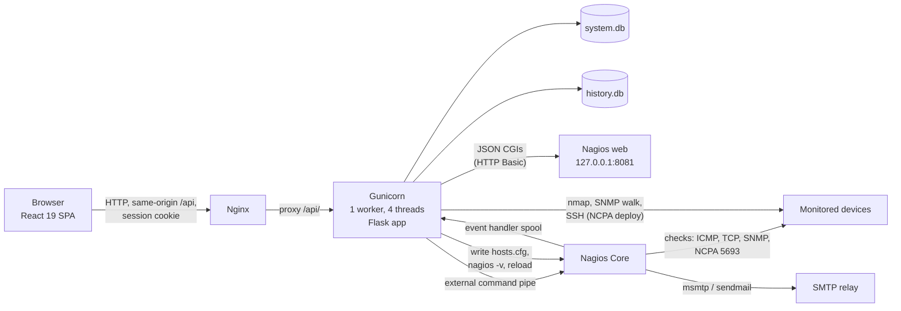

## 1. Technical system overview

### 1.1 Description and objectives

PinPoint is a network monitoring and administration web application for
network administrators who should not need Nagios's native interface.
**Nagios Core remains the monitoring engine.** PinPoint collects, stores,
aggregates and presents Nagios data, and generates the Nagios configuration
for the devices it discovers.

Objectives:

1. Present current network state and history in a role-aware web UI.
2. Discover devices and services automatically and turn them into validated
   Nagios configuration.
3. Manage who is alerted, when, and how (email, quiet hours, escalations,
   maintenance windows).
4. Offer bounded, audited automatic recovery (service restarts).
5. Keep everything on one on-premises server, with no cloud component.

### 1.2 Technical scope

| In scope | Out of scope (explicit exclusions) |
|---|---|
| One Ubuntu Server appliance hosting Nagios Core, the Flask backend, the built React client and two SQLite databases | Cloud or multi-node deployment |
| Discovery with nmap; SNMP and NCPA metrics | Automatic parent/topology inference, physical interface mapping, topology traffic panels |
| Manual multiple-parent topology | Nagios's native UI as an operator surface |
| Plugin management on the PinPoint/Nagios server | Installing arbitrary agents or plugins on monitored devices (NCPA excepted) |
| NCPA deployment over SSH (Linux), manual registration (Windows) | Active/passive failover |

Source: [`Implementation_Status.md`](../../spec%20files/Implementation_Status.md), "Explicit exclusions".

### 1.3 Core functions

Authentication and RBAC; dashboard and network health; device inventory with
port lifecycle and identity review; network discovery and Nagios config
generation; Plugin Manager; NCPA deployment; alert acknowledgement synced to
Nagios; alert and notification history; reports; email notification policy,
per-host recipients and escalations; maintenance windows; event-handler
remediation; resource forecasts; audit and Nagios logs; scheduled backups and
CLI restore.

### 1.4 High-level architecture

### 1.5 Limitations and dependencies

- **Single process scheduler:** Gunicorn must run one worker
  (`PINPOINT_SCHEDULER=1` only for that service); each process would start
  its own scheduler.
- **SQLite:** two file databases; no concurrent multi-server writers.
- **Nagios dependency:** if Nagios stops, data goes stale; PinPoint shows
  this on the Dashboard.
- **Installer dependency:** sudoers rules, helpers (`pinpoint-apply-smtp`,
  `pinpoint-apply-resources`, event handler), file ownership and Nginx are
  delivered by the separate installer.
- Known open gaps are listed in [`Implementation_Status.md`](../../spec%20files/Implementation_Status.md),
  "Incomplete or mismatched work". Notable ones: no email-based password
  recovery; custom plugin upload disabled; SNMPv3 passphrases briefly visible
  in the `check_snmp` child process list; several features not yet run on a
  live appliance or in a browser.
