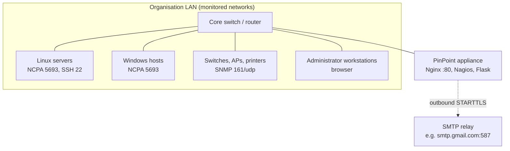
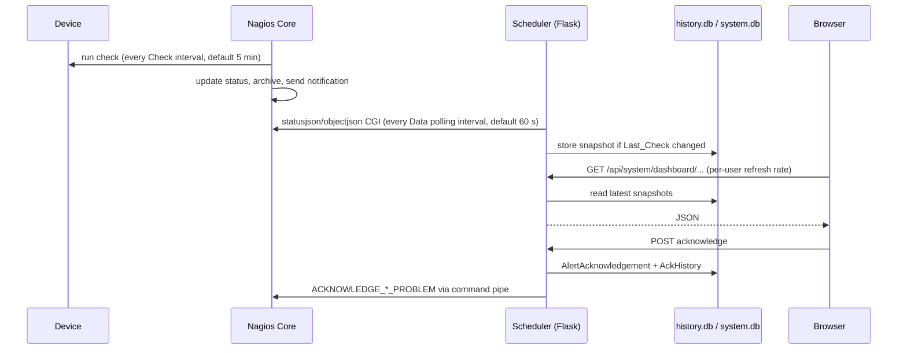

## 2. Architecture and design

### 2.1 Overall architecture

A three-tier, single-host design:

| Tier | Component | Notes |
|---|---|---|
| Presentation | React/TypeScript SPA built by Vite, served by Nginx **[A]** | All calls are same-origin `/api/...` with the Flask session cookie |
| Application | Flask 3 app under Gunicorn | Blueprints `/api/user`, `/api/system`, `/api/plugin`; APScheduler jobs in-process |
| Data / engine | SQLite `system.db`, `history.db`; Nagios Core 4.5.11 | Nagios owns check execution, state and notification dispatch |

**[A]** The installer's Nginx serves the built `client/dist` for `/`. The
repository's lab Nginx (`lab/appliance/nginx-pinpoint.conf`) proxies only
`/api/` and serves a placeholder at `/`. The installer's `deploy-pinpoint-web.sh`
writes the production site `/etc/nginx/sites-available/pinpoint` (listens on
port 80 only, `server_name _`) and removes the default site.

### 2.2 Software architecture

Backend (`server/app/`):

```text
api/user/        authentication, accounts, roles, preferences
api/system/      dashboard, health, hosts, services, history, reports, logs,
                 settings, discovery, NCPA, maintenance, remediation, ...
api/plugin/      Plugin Manager routes, reconciler, custom checks
api/helper/      responses, validation, permission decorator, DB access
api/commands/    flask CLI: seed, init-production, sync-permissions,
                 recover-bootstrap-admin, restore-backup
nagios/          CGI polling (status.py), archive (notifications.py),
                 command pipe (commands.py)
network_discovery/  nmap scans, identity reconciliation, port lifecycle,
                 hosts.cfg generation and apply
ncpa_deployment/ SSH-based NCPA installation
scheduler.py, automation.py, remediation.py, forecast.py, maintenance.py
system_models.py, plugin_models.py, history_models.py
```

Frontend (`client/src/`): `pages/` (routed pages), `components/`,
`contexts/` (current user, system settings), `hooks/`, `lib/` (`api.ts`,
`pageAccess.ts`), `types/` (wire-to-view adapters).

Full inventories: [`Backend_Modules_and_Routes.md`](../../spec%20files/Backend_Modules_and_Routes.md),
[`Frontend_Modules_and_Routes.md`](../../spec%20files/Frontend_Modules_and_Routes.md).

### 2.3 Hardware architecture

One server (physical or virtual) runs every PinPoint component. Monitored
devices are separate. Optional: an SMTP relay outside the server. See
section 3.

### 2.4 Network topology (logical)



Addressing, VLANs and firewall placement depend on the site and are not
recorded here (section 5.4).

### 2.5 Component relationships

| Component | Depends on | Used by |
|---|---|---|
| Flask API | SQLite, Nagios CGIs, command pipe, config files | React client |
| Scheduler | Flask app context, Nagios CGIs, spool folder | Dashboard freshness, history, remediation |
| Config writer (`create_host_cfg.py`) | Plugin Manager state, discovery data, settings, `nagios -v`, `systemctl reload nagios` | Discovery, settings saves, device edits, plugin enable/disable |
| Nagios Core | Generated `hosts.cfg`, plugins in `NAGIOS_PLUGIN_DIR`, `resource.cfg` | Checks, notifications, event handler |
| Event handler `/usr/local/sbin/pinpoint-event-handler` | Spool folder (installer) | Remediation consumer. Verified on an ISO install (2026-11-25, app commit `4d4ac90f`): the installer creates both. An older lab appliance lacked them |

### 2.6 Data flow and communication



Historical events (History page, reports) come from Nagios `archivejson.cgi`,
not from `history.db` snapshots. Current state and durable event history are
separate products by design.

### 2.7 Architecture diagrams

Diagrams in sections 1.4, 2.4 and 2.6 are drawn from the code. A fuller
software architecture diagram and a generic example deployment are in
[`docs/reference/Architecture_Diagrams.md`](../reference/Architecture_Diagrams.md);
the entity relationship diagram is generated and lives in
[`docs/reference/ERD.md`](../reference/ERD.md) (section 6.3). The capstone paper's
architecture figure (Chapter 4, Figure 61) is redrawn there as a layered overview,
with a list of differences.
