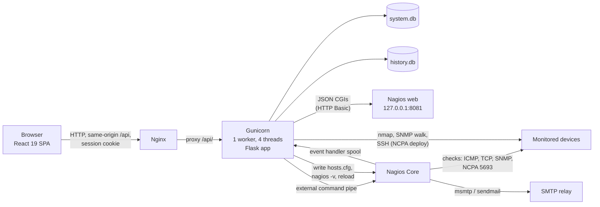
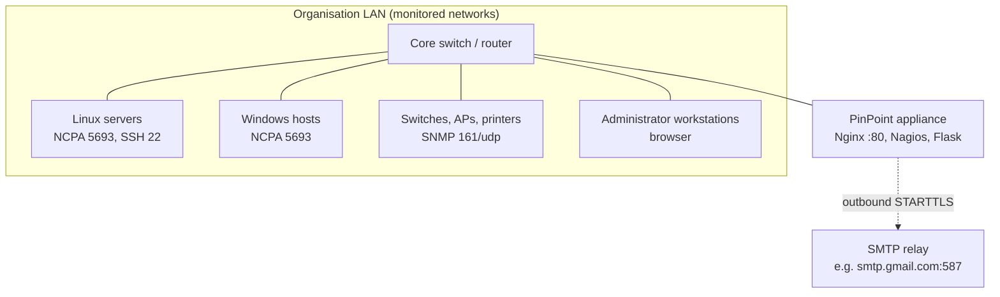
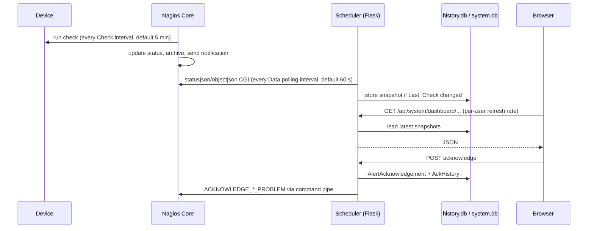

# PinPoint Network Diagnosis System

## Technical Manual

| | |
|---|---|
| Product | PinPoint (Detech-IT / 4D-G2) |
| Document | Technical Manual |
| Version | 0.1 (draft) |
| Status | Draft for owner review, issue #181 |
| Date | 2026-11-15 |
| Audience | Developers, network engineers, system administrators, IT staff and future maintainers |
| Companion | [User Manual](../User_Manual/User_Manual.md) |
| Source of truth | [`spec files/`](../../spec%20files/README.md); this manual summarises it and must not contradict it |

> **Draft notice.** This draft was written from the specifications, the topic
> guides in `docs/manuals/`, the model files and configuration in this
> repository. It was **not** checked against the separate installer
> repository (`lorraine-pangilinan/PinPoint-Installer`) or a named lab
> appliance. Installer-owned behaviour, hardware sizing and bandwidth figures
> are therefore marked **TBC**. Diagrams are drawn from the code as Mermaid
> diagrams; the capstone paper's architecture figure is redrawn and compared in
> section 2.7, and the ERD is generated from the schema (section 6.3).

### Labelling convention

| Label | Meaning |
|---|---|
| **[V]** Verified | Read from source code, a specification or a recorded lab report in this repository |
| **[A]** Assumption | A reasonable inference not stated in the repository |
| **[R]** Recommended | An improvement that is **not** implemented |
| **TBC** | To Be Confirmed; the information is not available in this repository |

Unlabelled statements in sections 1 to 11 are **[V]**.

---

## Table of contents

1. [Technical system overview](#1-technical-system-overview)
2. [Architecture and design](#2-architecture-and-design)
3. [Hardware requirements](#3-hardware-requirements)
4. [Software requirements](#4-software-requirements)
5. [Network requirements and configuration](#5-network-requirements-and-configuration)
6. [Database design and management](#6-database-design-and-management)
7. [Components and functional modules](#7-components-and-functional-modules)
8. [Installation and deployment](#8-installation-and-deployment)
9. [System security](#9-system-security)
10. [Testing and validation](#10-testing-and-validation)
11. [Maintenance and troubleshooting](#11-maintenance-and-troubleshooting)
12. [Scalability and future enhancements](#12-scalability-and-future-enhancements)
13. [Glossary and abbreviations](#13-glossary-and-abbreviations)
14. [Appendices](#14-appendices)

---

## 1. Technical system overview

### 1.1 Description and objectives

PinPoint is a network monitoring and administration web application for
network administrators who should not need Nagios's native interface.
**Nagios Core remains the monitoring engine.** PinPoint collects, stores,
aggregates and presents Nagios data, and generates the Nagios configuration
for the devices it discovers.

Objectives:

1. Present current network state and history in a role-aware web UI.
2. Discover devices and services automatically and turn them into validated
   Nagios configuration.
3. Manage who is alerted, when, and how (email, quiet hours, escalations,
   maintenance windows).
4. Offer bounded, audited automatic recovery (service restarts).
5. Keep everything on one on-premises server, with no cloud component.

### 1.2 Technical scope

| In scope | Out of scope (explicit exclusions) |
|---|---|
| One Ubuntu Server appliance hosting Nagios Core, the Flask backend, the built React client and two SQLite databases | Cloud or multi-node deployment |
| Discovery with nmap; SNMP and NCPA metrics | Automatic parent/topology inference, physical interface mapping, topology traffic panels |
| Manual multiple-parent topology | Nagios's native UI as an operator surface |
| Plugin management on the PinPoint/Nagios server | Installing arbitrary agents or plugins on monitored devices (NCPA excepted) |
| NCPA deployment over SSH (Linux), manual registration (Windows) | Active/passive failover |

Source: [`Implementation_Status.md`](../../spec%20files/Implementation_Status.md), "Explicit exclusions".

### 1.3 Core functions

Authentication and RBAC; dashboard and network health; device inventory with
port lifecycle and identity review; network discovery and Nagios config
generation; Plugin Manager; NCPA deployment; alert acknowledgement synced to
Nagios; alert and notification history; reports; email notification policy,
per-host recipients and escalations; maintenance windows; event-handler
remediation; resource forecasts; audit and Nagios logs; scheduled backups and
CLI restore.

### 1.4 High-level architecture



### 1.5 Limitations and dependencies

- **Single process scheduler:** Gunicorn must run one worker
  (`PINPOINT_SCHEDULER=1` only for that service); each process would start
  its own scheduler.
- **SQLite:** two file databases; no concurrent multi-server writers.
- **Nagios dependency:** if Nagios stops, data goes stale; PinPoint shows
  this on the Dashboard.
- **Installer dependency:** sudoers rules, helpers (`pinpoint-apply-smtp`,
  `pinpoint-apply-resources`, event handler), file ownership and Nginx are
  delivered by the separate installer.
- Known open gaps are listed in [`Implementation_Status.md`](../../spec%20files/Implementation_Status.md),
  "Incomplete or mismatched work". Notable ones: no email-based password
  recovery; custom plugin upload disabled; SNMPv3 passphrases briefly visible
  in the `check_snmp` child process list; several features not yet run on a
  live appliance or in a browser.

---

## 2. Architecture and design

### 2.1 Overall architecture

A three-tier, single-host design:

| Tier | Component | Notes |
|---|---|---|
| Presentation | React/TypeScript SPA built by Vite, served by Nginx **[A]** | All calls are same-origin `/api/...` with the Flask session cookie |
| Application | Flask 3 app under Gunicorn | Blueprints `/api/user`, `/api/system`, `/api/plugin`; APScheduler jobs in-process |
| Data / engine | SQLite `system.db`, `history.db`; Nagios Core 4.5.11 | Nagios owns check execution, state and notification dispatch |

**[A]** The installer's Nginx serves the built `client/dist` for `/`. The
repository's lab Nginx (`lab/appliance/nginx-pinpoint.conf`) proxies only
`/api/` and serves a placeholder at `/`; the production Nginx file is in the
installer (**TBC**).

### 2.2 Software architecture

Backend (`server/app/`):

```text
api/user/        authentication, accounts, roles, preferences
api/system/      dashboard, health, hosts, services, history, reports, logs,
                 settings, discovery, NCPA, maintenance, remediation, ...
api/plugin/      Plugin Manager routes, reconciler, custom checks
api/helper/      responses, validation, permission decorator, DB access
api/commands/    flask CLI: seed, init-production, sync-permissions,
                 recover-bootstrap-admin, restore-backup
nagios/          CGI polling (status.py), archive (notifications.py),
                 command pipe (commands.py)
network_discovery/  nmap scans, identity reconciliation, port lifecycle,
                 hosts.cfg generation and apply
ncpa_deployment/ SSH-based NCPA installation
scheduler.py, automation.py, remediation.py, forecast.py, maintenance.py
system_models.py, plugin_models.py, history_models.py
```

Frontend (`client/src/`): `pages/` (routed pages), `components/`,
`contexts/` (current user, system settings), `hooks/`, `lib/` (`api.ts`,
`pageAccess.ts`), `types/` (wire-to-view adapters).

Full inventories: [`Backend_Modules_and_Routes.md`](../../spec%20files/Backend_Modules_and_Routes.md),
[`Frontend_Modules_and_Routes.md`](../../spec%20files/Frontend_Modules_and_Routes.md).

### 2.3 Hardware architecture

One server (physical or virtual) runs every PinPoint component. Monitored
devices are separate. Optional: an SMTP relay outside the server. See
section 3.

### 2.4 Network topology (logical)



Addressing, VLANs and firewall placement depend on the site and are **TBC**
(section 5).

### 2.5 Component relationships

| Component | Depends on | Used by |
|---|---|---|
| Flask API | SQLite, Nagios CGIs, command pipe, config files | React client |
| Scheduler | Flask app context, Nagios CGIs, spool folder | Dashboard freshness, history, remediation |
| Config writer (`create_host_cfg.py`) | Plugin Manager state, discovery data, settings, `nagios -v`, `systemctl reload nagios` | Discovery, settings saves, device edits, plugin enable/disable |
| Nagios Core | Generated `hosts.cfg`, plugins in `NAGIOS_PLUGIN_DIR`, `resource.cfg` | Checks, notifications, event handler |
| Event handler `/usr/local/sbin/pinpoint-event-handler` | Spool folder (installer) | Remediation consumer |

### 2.6 Data flow and communication



Historical events (History page, reports) come from Nagios `archivejson.cgi`,
not from `history.db` snapshots. Current state and durable event history are
separate products by design.

### 2.7 Architecture diagrams

Diagrams in sections 1.4, 2.4 and 2.6 are drawn from the code. A fuller
software architecture diagram and a generic example deployment are in
[`docs/reference/Architecture_Diagrams.md`](../reference/Architecture_Diagrams.md);
the entity relationship diagram is generated and lives in
[`docs/reference/ERD.md`](../reference/ERD.md) (section 6.3). The capstone paper's
architecture figure (Chapter 4, Figure 61) is redrawn there as a layered overview,
with a list of differences.

---

## 3. Hardware requirements

### 3.1 Servers and workstations

| Item | Minimum | Recommended | Basis |
|---|---|---|---|
| PinPoint server CPU | 2 cores **[A]** | 4 cores | VM lab uses 4 vCPUs (`scripts/vmlab`) |
| Memory | 4 GB | 4 GB or more **[A]** | VM lab uses 4096 MB; Docker lab needs about 4 GB free |
| Disk | 40 GB | 40 GB plus room for history and 7 backups **[A]** | VM lab disk 40960 MB |
| Network interface | 1 × Ethernet on the monitored LAN | Wired, static address **[R]** | |
| Administrator workstation | Any computer with a current browser | | |

**TBC:** sizing for the production site's host count. Lab figures above come
from a 5–15 device lab, not a production measurement, and no named appliance
benchmark exists yet.

### 3.2 Routers and switches

PinPoint needs no specific router or switch. To use bandwidth charts the
devices must answer SNMP v1/v2c (interface discovery uses `snmpwalk -v2c`;
v3 is supported for checks but not for interface discovery).

### 3.3 Wireless access points

Not required. APs that answer ICMP or SNMP can be monitored like any host.

### 3.4 Storage

`system.db`, `history.db`, `DATABASE_BACKUP_DIR` (default
`server/database-backups`, newest 7 kept) and the Nagios archive directory
live on the server. The Dashboard warns below 10% free disk. **[R]** Copy
backups off the server (section 11.6).

### 3.5 Peripherals

None. A UPS for the server is **[R]**.

---

## 4. Software requirements

### 4.1 Operating system

| Role | OS | Basis |
|---|---|---|
| PinPoint appliance | Ubuntu Server 22.04.5 LTS | Installer contract |
| Monitored Linux hosts (NCPA deployment) | **TBC:** supported distributions | NCPA run reports used lab Linux targets |
| Monitored Windows hosts | Windows 10 observed with NCPA 3.5.0 (manual install) | #274 report |
| Development | Any OS with Python 3.14 and Node 22; dev container provided | `.devcontainer/` |

### 4.2 Languages, frameworks and libraries

| Layer | Component | Version (source) |
|---|---|---|
| Backend language | Python | 3.14 (`README.md`) |
| Web framework | Flask | 3.1.3 (`server/requirements.txt`) |
| ORM | SQLAlchemy / Flask-SQLAlchemy | 2.0.50 / 3.1.1 |
| Migrations | Alembic / Flask-Migrate | 1.18.4 / 4.1.0 |
| Sessions | Flask-Login | 0.6.3 |
| Scheduling | APScheduler | 3.11.3 |
| SSH | Paramiko | 5.0.0 |
| Discovery | python3-nmap | 1.9.1 (needs the `nmap` binary) |
| Encryption | cryptography (Fernet) | 50.0.0 |
| Frontend | React / React DOM | ^19.2.6 (`client/package.json`) |
| Language | TypeScript | ~6.0.2 |
| Build | Vite | ^8.0.12 |
| Routing | react-router-dom | ^7.17.0 |
| UI | Tailwind CSS, lucide-react, Recharts, @xyflow/react | ^4.3.0, ^1.17.0, ^3.8.1, ^12.11.0 |
| Tests | pytest; Vitest and Testing Library | `requirements-test.txt`; ^3.2.7 |

Lockfiles and requirements files are the source of truth for exact versions.

### 4.3 DBMS

SQLite (bundled with Python). No separate database server.

### 4.4 Web and application servers

| Component | Version / setting | Owner |
|---|---|---|
| Nginx | Distribution package; listens on 80 | Installer |
| Gunicorn | 1 worker, 4 threads, user `pinpoint`, service `pinpoint-gunicorn.service`, loopback `127.0.0.1:8000` **[A]** (lab config) | Installer |
| Nagios Core | 4.5.11; web UI moved to `127.0.0.1:8081` | Installer |
| Nagios Plugins | 2.4.12 | Installer |
| `check_ncpa.py` | 1.2.4 | Installer |
| msmtp (as `/usr/sbin/sendmail`) | Distribution package | Installer |
| nmap, snmp utilities (`snmpwalk`) | Distribution packages | Installer **[A]** |

### 4.5 Development tools

Git, GitHub CLI, Node 22 and npm, Python 3.14 with venv, Docker (local lab),
VirtualBox (VM lab), Playwright (QA smokes). See
[`Agent_Workflow_and_CI.md`](../../spec%20files/Agent_Workflow_and_CI.md).

### 4.6 Compatibility notes

- `interval_length=60` must hold in `nagios.cfg`.
- `check_ncpa.py` needs a `python` command or a python3 shebang on the
  appliance (fixed in the installer).
- Browser support: **TBC**.

---

## 5. Network requirements and configuration

> Sections 5.2 to 5.7 depend on the site. Values below are what the
> application needs; site-specific addressing and firewall configuration are
> **TBC** and must be confirmed with the installer maintainers.

### 5.1 Topology

PinPoint sits on, or routes to, every monitored subnet. Discovery uses nmap
directly, so the server must reach target addresses without NAT in between
**[A]**.

### 5.2 IP addressing and subnetting

| Item | Value |
|---|---|
| Monitored subnets | `PINPOINT_NETWORKS` (default `192.168.130.0/24`) or Settings → Network Discovery; a range larger than /16 is refused; localhost is never scanned |
| PinPoint server address | **[R]** Static address or DHCP reservation. **TBC:** what the installer configures |
| Monitored devices | DHCP or static; PinPoint tracks address changes through device identity evidence (NCPA certificate, SSH host key, MAC, machine ID, DNS name) |

### 5.3 Router and switch configuration

- Allow the PinPoint server's ICMP and TCP probes to every monitored subnet.
- Enable SNMP (read-only community, or v3 user) for devices whose interfaces
  you want charted, restricted to the PinPoint address **[R]**.

### 5.4 VLANs

Not required. With VLANs, route or trunk the PinPoint server to each VLAN.
**TBC:** site design.

### 5.5 Protocols and ports

| Direction | Protocol/port | Purpose | Basis |
|---|---|---|---|
| Users → PinPoint | TCP 80 (HTTP) | Web UI and `/api` via Nginx | Lab Nginx, installer contract |
| Users → PinPoint | TCP 443 (HTTPS) | **TBC:** not in the repository's lab config | |
| Loopback | TCP 8000 | Nginx → Gunicorn **[A]** | Lab Nginx |
| Loopback | TCP 8081 | Nagios web / JSON CGIs | Installer contract |
| PinPoint → devices | ICMP echo | `check-host-alive` and discovery | |
| PinPoint → devices | TCP/UDP, configured ports | nmap discovery and service checks | `config.py`, Settings |
| PinPoint → devices | UDP 161 | SNMP checks and interface discovery | |
| PinPoint → devices | TCP 22 | NCPA deployment, remote restart, SSH checks | `SSH_PORT` |
| PinPoint → devices | TCP 5693 (default) | NCPA agent API | `NCPA_PORT`; per-device port recorded |
| PinPoint → SMTP relay | TCP 587 STARTTLS | Alert and test email | Settings → Email |
| Administrator → PinPoint | TCP 22 | Server administration **[A]** | |

### 5.6 DNS, DHCP and gateway

PinPoint needs a default gateway to reach routed subnets and the SMTP relay,
and DNS to resolve the SMTP host. Device DNS names are optional identity
evidence. **TBC:** what the installer configures.

### 5.7 Firewall rules and network security

**[R]** Host firewall on the appliance (for example `ufw`):

| Rule | Reason |
|---|---|
| Allow inbound 80/443 from administrator subnets only | Limit UI exposure |
| Allow inbound 22 from administrator workstations only | Server administration |
| Deny all other inbound | 8000 and 8081 are loopback only |
| Allow outbound to monitored subnets and the SMTP relay | Monitoring and email |

On monitored hosts allow 5693/tcp (NCPA) and 22/tcp (deployment) only from the
PinPoint address. **TBC:** whether the installer configures a host firewall.

### 5.8 Bandwidth and connectivity

Monitoring traffic is small (periodic checks every 1–15 minutes); discovery
scans are bursty. **TBC:** measured bandwidth on a named appliance.

### 5.9 Remote access

There is no remote-access feature. **[R]** Reach the UI over a VPN rather
than exposing it to the internet.

### 5.10 Network monitoring and troubleshooting

| Symptom | Check |
|---|---|
| Scan finds nothing | `PINPOINT_NETWORKS` / saved networks; routing from the appliance; `nmap` runs |
| SNMP charts empty | Community/v3 credentials; UDP 161 reachable; interface selected in Device Inventory |
| NCPA metrics critical | 5693 reachable; agent running; `check_ncpa` enabled; token/certificate |
| No email | Settings → Email failure indicator; `/etc/msmtprc` via helper; outbound 587 |

---

## 6. Database design and management

### 6.1 Architecture

Two SQLite files through one Flask-SQLAlchemy `db.session`; the model's bind
selects the file.

| Database | Bind | Model files | Holds |
|---|---|---|---|
| `server/system.db` (`DATABASE_URL`) | default | `system_models.py`, `plugin_models.py` | Everything PinPoint produces: users, roles, settings, devices, acknowledgements, logs, plugins, remediation |
| `server/history.db` (fixed path next to `config.py`) | `history` | `history_models.py` | Nagios-sourced status and performance snapshots only |

Rule: a record's producer decides its database, not its topic.

### 6.2 Schema overview (main tables)

| Group | Tables |
|---|---|
| Identity and access | `PERMISSION`, `ROLE`, `ROLE_PERMISSION`, `USER`, `USER_PREFERENCES`, `PASSWORD_RESET_REQUEST` |
| Audit | `ACTIVITY_LOG`, `CONFIGURATION_CHANGES`, `EXPORT_LOG` |
| Discovery and devices | `NETWORK_DISCOVERY_STATUS`, `NETWORK_DISCOVERY`, `SKIPPED_SERVICE`, `OPEN_TCP_Services`, `OPEN_UDP_Services`, `DEVICE_PARENT`, `DEVICE_IDENTIFIER`, `DEVICE_ADDRESS_HISTORY`, `DEVICE_REVIEW_ITEM`, `DEVICE_INTERFACE` |
| Alerting | `ALERT_ACKNOWLEDGEMENT`, `ACK_HISTORY`, `NOTIFICATION_CURSOR`, `HOST_ALERT_RECIPIENT`, `ESCALATION`, `NOTIFICATION_POLICY` |
| Operations | `MAINTENANCE_WINDOW`, `MAINTENANCE_OCCURRENCE`, `RESOURCE_FORECAST`, `REMEDIATION_ACTION`, `REMEDIATION_RUN`, `REMEDIATION_CONSUMER_STATE` |
| NCPA | `SSH_CREDENTIALS`, `NCPA_DEPLOYMENT_STATUS`, `NCPA_DEPLOYMENT_RESULT`, `NCPA_DEPLOYMENT`, `NCPA_DEVICE_PARTITION` |
| Settings (singletons) | `SYSTEM_SETTINGS`, `DISCOVERY_SETTINGS`, `PLUGIN_SETTINGS`, `SMTP_SETTINGS`, `NETWORK_PROFILE` |
| Plugin Manager | `PLUGIN`, `PLUGIN_VERSION`, `PLUGIN_COMMAND`, `PLUGIN_COMMAND_OVERRIDE`, `PLUGIN_DEPENDENCY`, `PLUGIN_CONFIGURATION`, `PLUGIN_HISTORY`, plugin scan status |
| History bind | `HOST_STATUS`, `HOST_PERF_DATA`, `SERVICE_STATUS`, `SERVICE_PERF_DATA`, `PROGRAM_STATUS` |

Field-level detail: [`Data_Model_and_Integrations.md`](../../spec%20files/Data_Model_and_Integrations.md),
"Model inventory", and the model files themselves.

### 6.3 Entity relationship diagram

The full entity relationship diagram is generated from the models, so it is
always current: [`docs/reference/ERD.md`](../reference/ERD.md). It has an
overview of every table and relationship for skimming, then one diagram per
domain (accounts, settings, audit log, discovery and devices, NCPA deployment,
alerts, plugins, remediation, Nagios history) with every column, type and key.
A backend unit test fails when that file differs from the models. After a model
change, refresh it from `server/` with the virtual environment active:

```bash
python scripts/generate_erd.py
```

The diagram is built from the database schema (the model files), not from the
capstone paper's ERD (Chapter 3, Figure 4), which was a snapshot taken during the
project and is superseded by the generated file.

### 6.4 Keys, validation and integrity

- Every table has an integer surrogate primary key, except `DEVICE_PARENT`
  and `HOST_ALERT_RECIPIENT` (composite keys) and `NOTIFICATION_CURSOR`
  (keyed by user).
- Users are never deleted (`UserStatus`: Active, Inactive, Suspended); do not
  add delete cascades to user foreign keys. `NOTIFICATION_CURSOR` and
  `PASSWORD_RESET_REQUEST` carry legacy cascades.
- Strong device identifiers are unique on (`Kind`, `Value`).
- Fixed-value fields are Python `Enum` columns.
- Settings rows carry `Version` for optimistic concurrency (409 on conflict).
- `REMEDIATION_RUN.Event_Key` is unique per action (replay protection).
- Input is validated in route guard clauses before reaching the database,
  network, SSH or Nagios config.

### 6.5 Migrations

Multi-bind Flask-Migrate/Alembic in `server/migrations/`; every model change
ships a migration. From `server/` with the venv active:

```bash
flask db upgrade            # multi-database environment
flask sync-permissions      # add new permissions, grant to Super Admin
```

### 6.6 Backup and recovery

Automatic backups, once a day (`BACKUP_INTERVAL` in `automation.py`), (setting **Automatic Backups**) to
`DATABASE_BACKUP_DIR/YYYYMMDD-HHMMSS/`, newest 7 kept, using SQLite's online
backup. Restore with `flask restore-backup <folder> --yes` with the service
stopped. Not backed up: generated Nagios config, NCPA deployment key,
`/etc/pinpoint/pinpoint.env` (including `SECRET_KEY`). Runbook:
[Backup and restore](../manuals/Backup_and_Restore.md).

### 6.7 Access control

The database files are owned by the `pinpoint` service account and accessed
only by the application. Application-level access is RBAC (section 9).
Passwords are stored as hashes made by Werkzeug's `generate_password_hash`
(`User.set_password` in `system_models.py`). Stored secrets (SMTP password, custom-check
passwords, SNMPv3 passphrases) are Fernet-encrypted with a key from
`PINPOINT_SECRETS_KEY` or `SECRET_KEY`.

---

## 7. Components and functional modules

For each module: purpose, key inputs/outputs, dependencies, configuration,
failure points and maintenance notes. Route lists are in
[`Backend_Modules_and_Routes.md`](../../spec%20files/Backend_Modules_and_Routes.md);
per-file purposes in the
[code documentation inventory](../plans/Code_Documentation_Inventory.md).

### 7.1 Authentication and accounts (`api/user/`)

| Aspect | Detail |
|---|---|
| Purpose | Login/logout, current user, accounts, roles, permissions, preferences, first-run setup, forgot-password requests |
| Inputs / outputs | JSON credentials → session cookie; account and role CRUD |
| Dependencies | `USER`, `ROLE`, `PERMISSION`; Nagios config writer (users are Nagios contacts) |
| Configuration | Session timeout, strong password policy (Settings → Security) |
| Failure points | Nagios apply failure after an account save (shown as a warning) |
| Maintenance | `flask sync-permissions` after upgrades; `flask recover-bootstrap-admin` for lockout |

### 7.2 Monitoring views (dashboard, network health, hosts, services)

| Aspect | Detail |
|---|---|
| Purpose | Current state, summaries, trends, acknowledgement, Check now |
| Inputs / outputs | `history.db` latest snapshots → JSON; acknowledgement → `system.db` + Nagios command pipe |
| Dependencies | `nagios/status.py` poller; `api/system/statistics.py` |
| Configuration | Data polling interval (30/60/120/300 s), Check interval |
| Failure points | Stale data if Nagios or the scheduler stops; command pipe unavailable (`nagios_synced: false`) |

### 7.3 History and notifications

Reads `archivejson.cgi` for alert and notification events; joins PinPoint
acknowledgement history; header bell keeps a per-user unread cursor. Failure
point: Nagios archive unavailable → 502.

### 7.4 Network discovery and Nagios configuration (`network_discovery/`)

| Aspect | Detail |
|---|---|
| Purpose | nmap TCP/UDP discovery, identity reconciliation, port lifecycle, SNMP interface discovery, `hosts.cfg` generation |
| Inputs / outputs | Networks, ports, Port → Service tables → device records, `hosts.cfg` |
| Dependencies | `nmap`, `snmpwalk`, Plugin Manager state, `nagios -v`, `sudo systemctl reload nagios` |
| Configuration | `PINPOINT_NETWORKS`, `DiscoverySettings`, `PINPOINT_PORT_ARCHIVE_AFTER_DAYS` |
| Failure points | Nagios rejects candidate config → rolled back, error recorded; scan finds no host → failed status before changes |
| Maintenance | Sensitive module: injection and secret-exposure review on change |

### 7.5 Plugin Manager (`api/plugin/`)

Scans `NAGIOS_PLUGIN_DIR`, tracks status, versions, commands, overrides,
dependencies; enable/disable drives the reconciler, which attaches services
per discovered port and applies config once. Custom checks and server checks
add argument-driven services. Custom plugin upload is disabled in this
release.

### 7.6 NCPA deployment (`ncpa_deployment/`)

SSH host-key fingerprint retrieval and explicit trust, login checks, remote
install, authenticated listener verification, partition discovery,
per-device results, cancellation, failed-only cleanup, manual registration
for Windows. Failure points: SSH auth, fingerprint mismatch, agent
port blocked. Sensitive module.

### 7.7 Alerting configuration

Notification policy (quiet hours, options, renotify), per-host recipients,
escalations, email transport (`SMTP_SETTINGS` + root helper
`/usr/local/sbin/pinpoint-apply-smtp` writing `/etc/msmtprc`), HTML alert email
via `server/scripts/pinpoint_notify_email.py`.

### 7.8 Maintenance windows

`MAINTENANCE_WINDOW` and occurrences; `maintenance_windows` job every 60 s
schedules Nagios downtime through the command pipe with retries.

### 7.9 Remediation (automatic recovery)

Nagios event handler writes one JSON file per event to `REMEDIATION_SPOOL_DIR`;
the consumer (every 15 s) validates, applies safety controls (kill switch,
Maintenance Mode, downtime, acknowledgement, cooldown, hourly cap), records a
`REMEDIATION_RUN` and runs `record_only`, `restart_local_service` (allowlisted
units via sudo) or `restart_remote_service` (root-owned helper on the device
over SSH). Failure escalation sends a Nagios custom notification.

### 7.10 Forecasts, storage and logs

`resource_forecast` every 30 min (linear fit over 72 h for NCPA disk and
memory); storage measurement on dashboard status; five audit-log categories
and a bounded, redacted Nagios log tail.

### 7.11 Scheduler and automation

| Job | Cadence |
|---|---|
| Nagios status poll | Data polling interval (default 60 s) |
| Retention purge | Daily |
| Automation (backups, scheduled discovery, plugin update scan, security validation) | Checked every 5 min (`AUTOMATION_CHECK_MINUTES`); each task's cadence comes from settings |
| Maintenance windows | 60 s |
| Resource forecast | 30 min |
| Remediation consumer | 15 s |
| NCPA relocation | Every 5 min (`NCPA_RELOCATE_MINUTES`) |

Maintenance Mode stops automation except backups. Scheduled discovery runs
only after a first manual scan.

### 7.12 Frontend shell

`AdminLayout`, `Sidebar`, `Header`, `PageAccessGuard`,
`SessionTimeoutWatcher`, `MaintenanceBanner`; `pageAccess.ts` maps routes to
permissions (usability only; the server enforces).

---

## 8. Installation and deployment

> **TBC (installer).** Production installation is performed by the separate
> `PinPoint-Installer` repository. The steps below are this repository's side
> of the contract
> ([`Agent_Workflow_and_CI.md`, "Deployment environment"](../../spec%20files/Agent_Workflow_and_CI.md#deployment-environment-installer-contract)).
> The installer's exact order, upgrade behaviour and host configuration must
> be confirmed with its maintainers. Do not hand-install from this manual.

### 8.1 Prerequisites

- A server meeting section 3, with Ubuntu Server 22.04.5 LTS.
- Network access from the server to the monitored subnets and the SMTP relay.
- The installer media or repository (**TBC:** ISO or script).

### 8.2 What the installer does (from the contract)

1. Installs Nagios Core 4.5.11 and plugins; moves Nagios web to
   `127.0.0.1:8081`.
2. Clones `main` into `/opt/pinpoint/Network-Diagnosis-System`.
3. Builds the client: `npm ci && npm run build` in `client/`.
4. Writes settings to `/etc/pinpoint/pinpoint.env` (see 8.4).
5. Runs `flask db upgrade` (multi-database) and `flask init-production`
   (reference data and one bootstrap administrator flagged for setup).
6. Installs helpers and sudo rights: `pinpoint-apply-smtp`,
   `pinpoint-apply-resources`, restart sudoers drop-in, event handler and
   spool folder. See [Installer handoff](../archive/plans/Installer_Handoff.md).
7. Runs `server/` under Gunicorn as `pinpoint-gunicorn.service` (1 worker,
   4 threads, user `pinpoint`, `PINPOINT_SCHEDULER=1`) behind Nginx.
8. Runs its health check.

### 8.3 Service account rights required

The `pinpoint` account must be able to: write `hosts.cfg`; run `nagios -v`;
`sudo systemctl reload nagios`; write its database files and
`DATABASE_BACKUP_DIR`; write the Nagios command pipe (group `nagios`); run the
named helpers with no other sudo rights. Writing to the plugin directory is
intentionally **not** granted.

### 8.4 Environment variables and configuration files

All settings are environment variables in `/etc/pinpoint/pinpoint.env`; the
full table is in the root
[`README.md`, "Production settings"](../../README.md#production-settings).
Required in production: `SECRET_KEY`, `NAGIOS_HOST`, `NAGIOS_PORT`,
`NAGIOS_USERNAME`, `NAGIOS_PASSWORD`, `PINPOINT_NETWORKS`,
`PINPOINT_SCHEDULER` (`1` for Gunicorn only), `FLASK_DEBUG=0`.

Credential locations (values are never written in this manual):

| Credential | Where it is stored |
|---|---|
| `SECRET_KEY`, `PINPOINT_SECRETS_KEY`, Nagios CGI user and password | `/etc/pinpoint/pinpoint.env` |
| Bootstrap administrator placeholder email and password | Created by the installer; **TBC:** where the installer reports them |
| SMTP password | `SMTP_SETTINGS.Password_Encrypted` (Fernet) and `/etc/msmtprc` (root helper) |
| Custom-check passwords, SNMPv3 passphrases | Encrypted in `system.db`; written to the Nagios resource file at config time |
| NCPA deployment SSH key and NCPA token | **TBC:** on-disk location |

### 8.5 Service start-up and verification

```bash
sudo systemctl status pinpoint-gunicorn.service
sudo systemctl status nagios        # TBC: unit name on the appliance
journalctl -u pinpoint-gunicorn
```

Then open `http://<server>/`, sign in with the bootstrap administrator and
complete first-run setup (User Manual 2.4).

### 8.6 Post-installation testing

1. Dashboard shows **Monitoring System** running and a recent update time.
2. Settings → Email: send a test email.
3. Run a one-address scan of a known host; it appears in Device Inventory.
4. Enable `check_ssh` (or another port plugin); the host's service appears.
5. Stop the service on the host; an alert appears and an email is received.
6. Check System Logs for the configuration changes.

### 8.7 Development setup

See the root [`README.md`](../../README.md) "Development setup": backend
`cd server && source .venv/bin/activate && flask run`; frontend
`cd client && npm install && npm run dev`. Local Docker lab:
[Local lab](../manuals/Local_Lab.md).

---

## 9. System security

### 9.1 Authentication and authorization

- Session-cookie authentication (Flask-Login); a second login in the same
  session is refused (409).
- Every data route uses `@login_required` and
  `@require_permission("<name>")`; the client guard is only usability.
- Session timeout 15–240 minutes (Settings → Security).
- Bootstrap administrator must complete setup; protected from losing
  account/role administration.

### 9.2 Role-based access control

Roles hold permissions (list in User Manual 5.2 and
[`Backend_Modules_and_Routes.md`](../../spec%20files/Backend_Modules_and_Routes.md)).
`Super Admin` has an immutable full set. New permissions are added by
`flask sync-permissions`.

### 9.3 Password protection

Strong policy option (12+ characters with four classes); reuse of the current
password refused; forced change after admin reset. Password recovery is
administrator-mediated (no email reset).

### 9.4 Encryption and secure communication

| Path | Protection |
|---|---|
| Browser ↔ PinPoint | HTTP on port 80 in the lab. **TBC:** HTTPS on production. **[R]** Enable TLS in Nginx with an internal CA or Let's Encrypt and set secure cookie flags |
| PinPoint ↔ SMTP | STARTTLS required (Gmail or custom relay) |
| PinPoint ↔ NCPA | NCPA HTTPS API with token |
| PinPoint ↔ devices (SSH) | Pinned host-key fingerprint, explicit trust |
| Secrets at rest | Fernet encryption in `system.db`; protected Nagios resource file |

### 9.5 Firewall and network protection

See 5.7. Nagios web and Gunicorn listen on loopback.

### 9.6 Data privacy

Monitoring data stays on the appliance. Personal data held: account names and
emails, activity logs. Secrets are never returned by the API or logged; Nagios
log view redacts command text and plugin output.

### 9.7 Security logging and monitoring

Activity, configuration, discovery, NCPA and export logs; failed-login
monitoring and audit logging toggles; plugin security validation on a
schedule.

### 9.8 Vulnerability management

Pinned dependencies; CI runs on every pull request. **[R]** Add dependency
scanning (`pip-audit`, `npm audit`) and OS unattended security updates.

### 9.9 Known security gaps and recommendations

| Item | Status | Recommendation |
|---|---|---|
| HTTPS | **TBC** | **[R]** TLS on Nginx, HSTS, secure cookies |
| SNMPv3 passphrases in `check_snmp` child argv | Known gap | **[R]** Replace the v3 client with one reading a protected file |
| Narrower `nagios` group rights for event handlers | Open installer item | Complete in installer |
| No account lockout or login rate limiting; failed logins are only recorded in the activity log when Failed Login Monitoring is on (`api/user/login.py`) | Gap | **[R]** Add rate limiting in Nginx or the app |
| Backups not copied off the host | By design | **[R]** Encrypted off-host copy |

---

## 10. Testing and validation

### 10.1 Levels

| Type | Where | How to run |
|---|---|---|
| Backend unit and mocked API/DB | `server/tests/unit/` | `scripts/verify.sh backend` |
| Frontend unit and interaction | `client/src/test/` (Vitest) | `scripts/verify.sh frontend` |
| Docs and drift checks | `scripts/` | `scripts/verify.sh docs` |
| Integration (real Nagios CGIs) | `server/tests/integration/` | Opt-in; needs a lab Nagios |
| End-to-end lab | `server/tests/e2e/`, `scripts/lab`, `scripts/vmlab` | Opt-in |
| QA black-box cases | [Case catalog](../qa/Pinpoint%20-%20Black-Box%20Test%20Cases%20by%20Module%20with%20Traceability%20Matrix.md) | Manual and Playwright; [QA scope](../qa/QA_Journeys_and_Scope.md) |

CI (`.github/workflows/ci.yml`) runs docs, backend and frontend jobs on every
pull request; all three block merging.

### 10.2 Functional and integration testing

Covered by the unit suites and recorded lab runs in
[`docs/test-runs/`](../test-runs/README.md).

### 10.3 Network connectivity testing

From the appliance: `ping <host>`, `nmap -p <port> <host>`,
`snmpwalk -v2c -c <community> <host> 1.3.6.1.2.1.1` (do not paste the
community into tickets), `curl -k https://<host>:5693/` for NCPA reachability
**[A]**.

### 10.4 Performance testing

**TBC:** no recorded performance test. The rows-per-host measurement is
deferred (#82). **[R]** Measure poll duration and database growth at the
expected host count.

### 10.5 Security testing

Unit tests check argv secrecy, input validation and permission denials.
**[R]** A periodic authenticated scan (for example OWASP ZAP) of the UI.

### 10.6 User acceptance testing

Use the black-box case catalog and QA journeys; record results in
`docs/test-runs/`.

### 10.7 Sample test cases

| ID | Test | Expected result |
|---|---|---|
| T-01 | Sign in with an Inactive account | "Account inactive." |
| T-02 | Viewer opens `/accounts` by URL | Access denied; API returns 403 |
| T-03 | Acknowledge an alert with a comment | Badge shown; History records actor and comment; Nagios shows acknowledged |
| T-04 | Scan one known address | Device appears; no change to saved networks |
| T-05 | Enable `check_ssh` | SSH services appear for hosts with port 22 |
| T-06 | Save an invalid Nagios setting that Nagios rejects | Config rolled back; error shown |
| T-07 | `flask restore-backup` while service runs | Refused; nothing changed |
| T-08 | Stop the poller | Dashboard freshness warning |

### 10.8 Error handling and validation

Routes return standard `success`/`error` envelopes; validation uses guard
clauses; failed commits roll back; Nagios-rejected configs roll back with
`422`; settings conflicts return `409`.

---

## 11. Maintenance and troubleshooting

### 11.1 Routine maintenance

| Task | Frequency **[R]** |
|---|---|
| Check Dashboard storage and backup health | Weekly |
| Review System Logs for failed logins and config changes | Weekly |
| Review Device Inventory Needs Review items | Weekly |
| Copy a backup off the server | Weekly |
| Apply OS security updates | Monthly or per policy |

### 11.2 Updates and patching

Upgrades are delivered by the installer (**TBC:** upgrade command). After any
application upgrade: `flask db upgrade` then `flask sync-permissions`.

### 11.3 Hardware maintenance

Monitor free disk (Dashboard warns below 10%); keep the server on a UPS
**[R]**.

### 11.4 Network monitoring

Use PinPoint itself; also watch the appliance's own `localhost` checks.

### 11.5 Database optimisation

Retention settings purge old logs and diagnostic history daily. **[R]**
Occasional `VACUUM` of `history.db` during a maintenance window with the
service stopped (**TBC:** not documented by the project).

### 11.6 Backup and restore

See 6.6 and [Backup and restore](../manuals/Backup_and_Restore.md). Also keep
a secure copy of `/etc/pinpoint/pinpoint.env`; without the same `SECRET_KEY`
stored passwords cannot be decrypted.

### 11.7 Common technical errors

| Error | Cause | Fix |
|---|---|---|
| Startup: "must be a number greater than zero" / "must be on or off" | Invalid environment value | Fix `/etc/pinpoint/pinpoint.env` |
| Dashboard stale | Scheduler off or Nagios stopped | `PINPOINT_SCHEDULER=1` on Gunicorn only, one worker; check Nagios |
| Nagios calls 401 | Wrong `NAGIOS_USERNAME`/`NAGIOS_PASSWORD` | Correct the env file |
| Stored passwords stopped working | `SECRET_KEY`/`PINPOINT_SECRETS_KEY` changed | Restore the key or re-enter passwords |
| `flask db upgrade` fails on old server | Built with `db.create_all()` | See root README "Database setup" |
| `flask` commands start the poller | `PINPOINT_SCHEDULER` set in shell | Unset it |
| Acknowledgement not in Nagios | Command pipe not writable | Add `pinpoint` to group `nagios`; check pipe path |
| Email fails | Helper missing, relay rejects | Settings → Email failure indicator; Nagios log |

### 11.8 Diagnostic procedure

1. Read Dashboard **Monitoring System** and freshness.
2. `systemctl status pinpoint-gunicorn nginx` and the Nagios service.
3. `journalctl -u pinpoint-gunicorn -n 200`.
4. System Logs → Nagios log tab.
5. Validate Nagios config: `sudo -u pinpoint /usr/local/nagios/bin/nagios -v /usr/local/nagios/etc/nagios.cfg` **[A]** (path from `NAGIOS_BIN`, `NAGIOS_MAIN_CFG`).

### 11.9 Recovery procedures

- Locked-out administrator: `flask recover-bootstrap-admin`.
- Corrupt database: stop service, `flask restore-backup <folder> --yes`,
  follow printed steps.
- Bad Nagios config: the writer keeps a backup and rolls back rejected
  candidates; regenerate by saving a device or running a scan.
- Replacement host: install, restore env values (same `SECRET_KEY`), copy
  backup, restore.

---

## 12. Scalability and future enhancements

### 12.1 Current limitations

One Gunicorn worker; SQLite; one appliance; no failover; several features
without live verification (see `Implementation_Status.md`).

### 12.2 Performance recommendations [R]

- Raise the Data polling interval and Check interval for large networks.
- Shorter diagnostic retention to bound `history.db`.
- Schedule discovery off-hours.

### 12.3 Scalability [R]

- Move to PostgreSQL if write contention appears (requires code and
  migration work; not planned).
- Separate the scheduler into its own process to allow multiple web workers.
- Nagios distributed checking for remote sites.

### 12.4 Additional hardware or software [R]

| Item | Purpose | Importance |
|---|---|---|
| UPS | Avoid database corruption on power loss | High |
| Off-host backup target (NAS) | Survive server loss | High |
| TLS certificate | Encrypt UI traffic and credentials | High |
| Secondary SMTP relay | Alert delivery if the primary fails | Medium |
| Standby appliance | Faster cold-standby recovery | Medium |

### 12.5 Security improvements [R]

HTTPS everywhere; login rate limiting; dependency scanning; SNMPv3 credential
transport fix; MFA for administrators.

### 12.6 Proposed enhancements

Email-based password recovery (open gap), forecast notifications (follow-up),
History page wiring for custom ranges (#142), acknowledgement filter on host
and service tables, custom plugin upload decision.

---

## 13. Glossary and abbreviations

| Term | Meaning |
|---|---|
| API | Application Programming Interface |
| CGI | Common Gateway Interface; Nagios exposes JSON CGIs |
| CI | Continuous Integration |
| CIDR | Classless Inter-Domain Routing notation for subnets |
| ERD | Entity Relationship Diagram |
| Fernet | Symmetric authenticated encryption from the `cryptography` library |
| HARD/SOFT state | Nagios confirmed vs unconfirmed state |
| NCPA | Nagios Cross-Platform Agent |
| nmap | Network scanner used for discovery |
| ORM | Object-Relational Mapper (SQLAlchemy) |
| RBAC | Role-Based Access Control |
| SNMP | Simple Network Management Protocol |
| SPA | Single-Page Application |
| STARTTLS | Upgrade of a plain SMTP connection to TLS |
| TBC | To Be Confirmed |
| TLS | Transport Layer Security |
| UPS | Uninterruptible Power Supply |
| VLAN | Virtual LAN |

---

## 14. Appendices

### Appendix A. Reference documents

| Topic | Document |
|---|---|
| Specification index | [`spec files/README.md`](../../spec%20files/README.md) |
| Architecture | [`System_Overview_and_Architecture.md`](../../spec%20files/System_Overview_and_Architecture.md) |
| Routes | [`Backend_Modules_and_Routes.md`](../../spec%20files/Backend_Modules_and_Routes.md), [`Frontend_Modules_and_Routes.md`](../../spec%20files/Frontend_Modules_and_Routes.md) |
| Data and integrations | [`Data_Model_and_Integrations.md`](../../spec%20files/Data_Model_and_Integrations.md) |
| Standards | [`Engineering_Standards.md`](../../spec%20files/Engineering_Standards.md) |
| Status and gaps | [`Implementation_Status.md`](../../spec%20files/Implementation_Status.md) |
| Plugins | [`Plugins_List.md`](../../spec%20files/Plugins_List.md) |
| Operator guides | [`docs/manuals/`](../manuals/README.md) |

### Appendix B. Items to be confirmed (questions for the owners)

| # | Item | Section | Question |
|---|---|---|---|
| 1 | Installer order and upgrades | 8 | What does the installer do, in order, on a fresh appliance and on upgrade? |
| 2 | HTTPS | 5.5, 9.4 | Does the production Nginx serve TLS? With which certificate? |
| 3 | Host firewall | 5.7 | Does the installer configure `ufw` or similar? Which rules? |
| 4 | Server addressing, DNS, gateway | 5.2, 5.6 | Does the installer set a static address? |
| 5 | Production Nginx config | 2.1 | Where is it, and does it serve `client/dist`? |
| 6 | Sizing | 3.1 | Expected host count; measured CPU, memory, disk and bandwidth on a named appliance |
| 7 | Supported monitored OSes | 4.1 | Which Linux distributions does NCPA deployment support? |
| 8 | Bootstrap credentials location | 8.4 | Where does the installer report the placeholder login? |
| 9 | NCPA key and token location | 8.4 | Where are they stored on disk? |
| 10 | Backup time of day | 6.6 | Backups run once a day when due; is a fixed time wanted? |

### Appendix C. Not covered by this draft

- DOCX and PDF export for the capstone appendix (issue #181 section G).
- Verification against the installer repository (section H).
- Screenshots and measurements from a named lab appliance.
