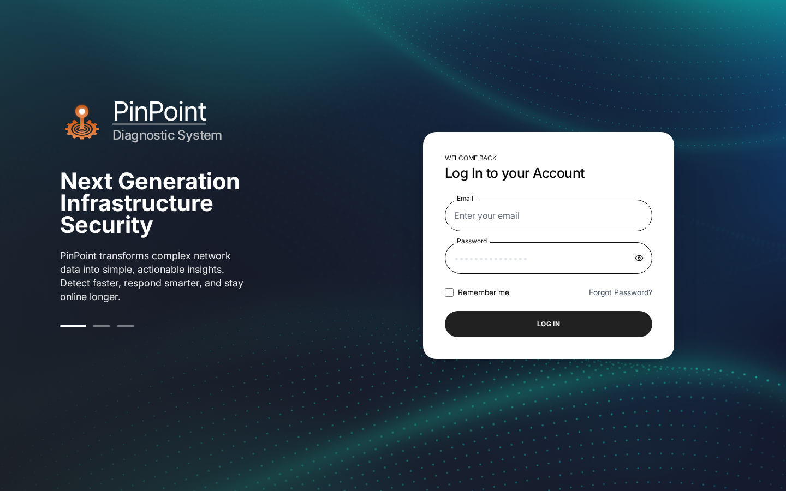
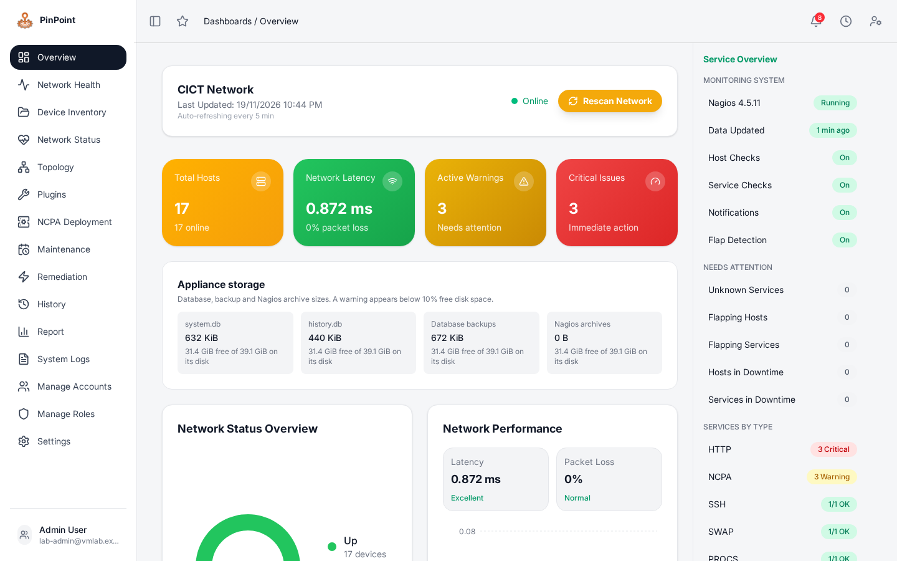

## 2. Getting started

### 2.1 Minimum user requirements

| Item | Requirement |
|---|---|
| Device | A desktop or laptop computer. Pages fit a tablet-sized screen in an emulated check, not on a real tablet. Phones are not supported: pages do not fit the screen |
| Browser | A current version of Chrome, Edge or Firefox (at least Chrome or Edge 111, Firefox 128) |
| Network | Your computer must reach the PinPoint server over the organisation's network |
| Account | A PinPoint account created by an administrator. There is no self-registration |
| Knowledge | Basic computer use. No Nagios or networking knowledge is needed to read the Dashboard |

### 2.2 How to access the system

1. Ask your administrator for the PinPoint address. It is the address of the
   PinPoint server, for example `http://<server-address>/`.
   The installer serves plain `http://`; an administrator may add `https://`
   (Technical Manual, section 9).
2. Type the address in your browser's address bar.
3. The sign-in page opens. Any page that needs you to be signed in sends you
   here first.

*Figure UM-01. The sign-in page: email, password, **Remember me**, **Log In** and **Forgot Password?**.*

### 2.3 Registration and login

There is no self-registration. An administrator creates your account and gives
you a temporary password through a channel you both trust. If your account is
flagged **Must change password**, you must set a new password before you can use
other pages. Signing in, signing out, session timeout and **Remember me** are
described in [Sign in, accounts and roles](guides/Login_Accounts_and_Roles.md).

### 2.4 Initial setup (first administrator only)

The first sign-in on a new installation opens a setup window that cannot be
skipped; see [Sign in, accounts and roles](guides/Login_Accounts_and_Roles.md#first-run-setup-new-installation).
After that, the administrator should, in order:

1. [Set up the email server](guides/Email_Settings.md).
2. [Choose the networks to scan and run the first scan](guides/Network_Discovery.md).
   Pinpoint does not scan on its own until a first scan has been run by hand.
3. [Switch on the checks you need](guides/Plugin_Manager.md). None is enabled on
   a new installation.
4. [Create accounts for the team](guides/Login_Accounts_and_Roles.md#manage-accounts-administrators).

### 2.5 Overview of the interface

*Figure UM-02. After sign-in: the sidebar is on the left, the header runs across the top, and the Dashboard fills the main area.*

| Area | What it holds |
|---|---|
| **Sidebar** (left) | Links to the pages your role allows. Pages you cannot use are hidden |
| **Header** (top) | Current page name, the notification **bell**, your account and sign-out |
| **Main area** | The page you opened |
| **Maintenance banner** | A coloured strip across the top while Maintenance Mode is on |
