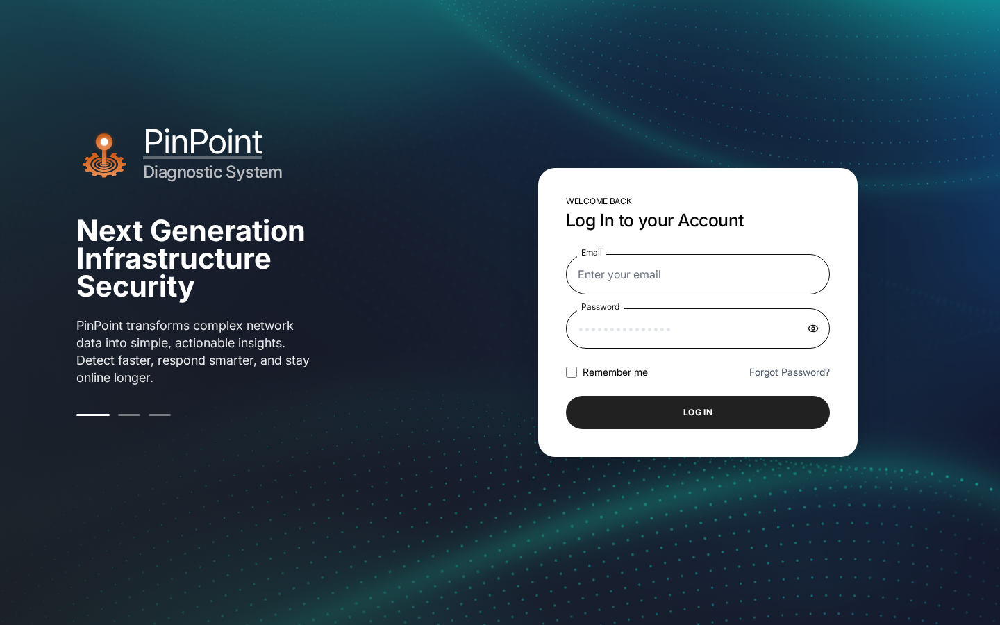
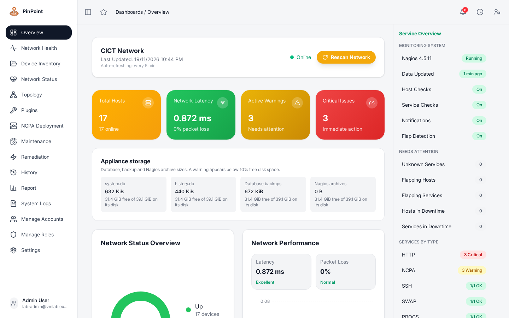
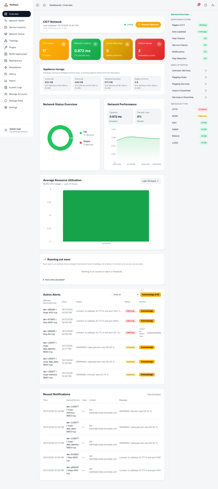
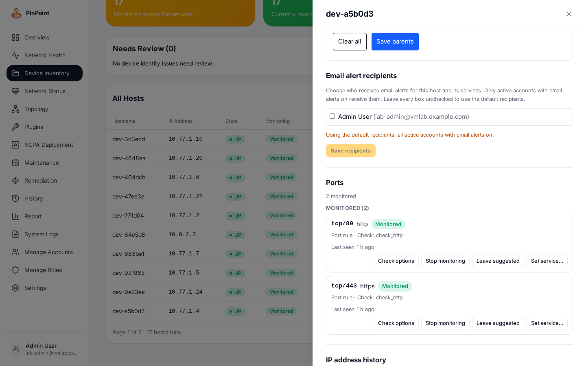

# PinPoint Network Diagnosis System

## User Manual

| | |
|---|---|
| Product | PinPoint (Detech-IT / 4D-G2) |
| Document | User Manual |
| Version | 0.1 (draft) |
| Status | Draft for owner review, issue #181 |
| Date | 2026-11-15 |
| Audience | Network administrators, IT staff and supervisors who use PinPoint in a web browser |
| Companion | [Technical Manual](../Technical_Manual/Technical_Manual.md) |

> **Draft notice.** This draft was written from the repository's specifications
> and topic guides (`spec files/`, `docs/manuals/`). The screenshots were taken
> on a disposable demo lab (light theme, 14 demo devices); the written steps
> have not yet all been followed on it. Items marked **TBC** (To Be
> Confirmed) need a check on a running system before the manual is final.

### How to read this manual

| Label | Meaning |
|---|---|
| (no label) | Taken from the specifications or source code |
| **TBC** | Not confirmed; needs a check on a running PinPoint |
| **Tip** | A recommended way of working; not a product feature |

Words in **bold** are buttons, menu items or page names as they appear on
screen. A path such as **Settings → Email** means "open Settings, then choose
the Email tab".

---

## Table of contents

1. [Introduction](#1-introduction)
2. [Getting started](#2-getting-started)
3. [System navigation](#3-system-navigation)
4. [Step-by-step operating instructions](#4-step-by-step-operating-instructions)
5. [User roles and permissions](#5-user-roles-and-permissions)
6. [Troubleshooting and FAQ](#6-troubleshooting-and-faq)
7. [Best practices](#7-best-practices)
8. [Glossary](#8-glossary)
9. [Appendices](#9-appendices)

---

## 1. Introduction

### 1.1 Overview and purpose

PinPoint is a web application that shows the health of an organisation's
network in one place. It answers questions such as:

- Is any device or service down right now?
- What went wrong yesterday, and who handled it?
- Which devices are on the network, and which of them are being watched?

PinPoint does not do the checking itself. A proven monitoring program called
**Nagios Core** runs on the same server and checks each device every few
minutes. PinPoint reads Nagios's results, stores them, and presents them in
plain pages, so you do not need to learn Nagios's own screens.

PinPoint runs on one server inside your network. It has no cloud component:
your monitoring data stays on that server.

### 1.2 Main features

| Feature | What it does for you | Page |
|---|---|---|
| Dashboard | One-page answer to "is anything broken right now?" | Dashboard |
| Network health | Deeper view of hosts, services, trends and bandwidth | Network Health, Network Status |
| Device inventory | Every device found on the network and why each port is or is not watched | Device Inventory |
| Network discovery | Scans your networks and finds devices and open ports automatically | Settings → Network Discovery |
| Alert acknowledgement | Mark a problem as "known and being handled", with a comment | Dashboard, Network Health, Network Status |
| History | Past alerts and notifications, with who acknowledged them | History |
| Topology | Picture of which device depends on which (parents you set) | Topology |
| Email alerts | Sends formatted alert email to chosen people | Settings → Email, Manage Accounts |
| Maintenance windows | Silences alerts during planned work | Maintenance |
| Automatic recovery | Restarts a failed service by itself, within safe limits | Remediation |
| Reports | Availability and event reports for a period, with export | Reports |
| Plugin Manager | Chooses which kinds of checks are switched on | Plugin Manager |
| NCPA deployment | Installs a small agent on servers so CPU, memory and disk can be watched | NCPA Deployment |
| Accounts and roles | Controls who can sign in and what each person can see and do | Manage Accounts, Manage Roles |

### 1.3 Intended users

| User | Typical tasks |
|---|---|
| Network administrator | Watches the Dashboard, acknowledges alerts, scans networks, manages devices and checks |
| IT staff / help desk | Reads current status and history, acknowledges alerts they are handling |
| Supervisor or manager | Reads the Dashboard and Reports |
| System administrator (Super Admin) | Manages accounts, roles, settings, email and backups |

The exact pages each person sees depend on their **role** (see
[section 5](#5-user-roles-and-permissions)).

### 1.4 Benefits and practical applications

- **Faster response:** problems appear on the Dashboard within minutes, and
  alert email can reach the right person.
- **Less noise:** acknowledgement, maintenance windows, quiet hours and
  flap detection reduce repeated or unwanted alerts.
- **Accountability:** every acknowledgement records who, when and why, and
  System Logs record configuration changes.
- **No Nagios training needed:** staff use PinPoint's pages instead of Nagios's
  native interface.

Practical examples: a school computer laboratory watching its switches and
servers; a small office checking that its file server, web server and printer
stay reachable; an IT team proving service availability for a month with a
report.

---

## 2. Getting started

### 2.1 Minimum user requirements

| Item | Requirement |
|---|---|
| Device | A desktop or laptop computer. **TBC:** use on tablets and phones has not been tested |
| Browser | A current version of Chrome, Edge or Firefox. **TBC:** the list of supported browsers and versions has not been confirmed |
| Network | Your computer must reach the PinPoint server over the organisation's network |
| Account | A PinPoint account created by an administrator. There is no self-registration |
| Knowledge | Basic computer use. No Nagios or networking knowledge is needed to read the Dashboard |

### 2.2 How to access the system

1. Ask your administrator for the PinPoint address. It is the address of the
   PinPoint server, for example `http://<server-address>/`.
   The installer serves plain `http://`; an administrator may add `https://`
   (Technical Manual, section 9).
2. Type the address in your browser's address bar.
3. The sign-in page opens. Any page that needs you to be signed in sends you
   here first.

*Figure UM-01. The sign-in page: email, password, **Remember me**, **Log In** and **Forgot Password?**.*

### 2.3 Registration and login

There is no self-registration. An administrator creates your account
([section 4.13](#413-add-a-user-account-administrators)) and gives you a
temporary password through a channel you both trust.

**Sign in**

1. Enter your **email** and **password**.
2. Optionally tick **Remember me**. It keeps you signed in for 30 days and
   ignores the session timeout; use it only on a computer you trust.
3. Choose the sign-in button. You land on the first page your role allows,
   normally the **Dashboard**.

**First sign-in with a temporary password**

If your account is flagged **Must change password**, a window asks for your
current (temporary) password and a new one, typed twice. You cannot use other
pages until this is done.

**Sign out**

Use the sign-out control in the header. To switch to another account you must
sign out first; signing in while already signed in is refused with "You are
already signed in. Sign out before logging in to another account."

**Session timeout**

If you leave PinPoint idle for longer than the timeout set by your
administrator (15 minutes to 4 hours), you are signed out with "Session
expired. Please log in again."

Full guide: [Sign in, accounts and roles](../manuals/Login_Accounts_and_Roles.md).

### 2.4 Initial setup (first administrator only)

A new installation has one administrator account created by the installer,
with a placeholder email ending in `@pinpoint.lan` and a placeholder password.
Where to find these placeholder values is described in the Technical Manual,
section 8; this manual never prints them.

The first sign-in with that account opens a **setup window** that cannot be
skipped:

1. Enter the **current password** (the installer's).
2. Enter your real **new email** (the `pinpoint.lan` domain is refused).
3. Enter a **new password** twice and save.

After that, the administrator should, in order:

1. Set the email server ([4.15](#415-set-up-alert-email-administrators)).
2. Choose the networks to scan and run the first scan
   ([4.9](#49-scan-the-network-for-devices)). PinPoint does not scan on its
   own until a first scan has been run by hand.
3. Switch on the checks you need in Plugin Manager
   ([4.11](#411-switch-on-a-kind-of-check-plugin-manager)).
4. Create accounts for the team ([4.13](#413-add-a-user-account-administrators)).

### 2.5 Overview of the interface

*Figure UM-02. After sign-in: the sidebar is on the left, the header runs across the top, and the Dashboard fills the main area.*

| Area | What it holds |
|---|---|
| **Sidebar** (left) | Links to the pages your role allows. Pages you cannot use are hidden |
| **Header** (top) | Current page name, the notification **bell**, your account and sign-out |
| **Main area** | The page you opened |
| **Maintenance banner** | A coloured strip across the top while Maintenance Mode is on |

---

## 3. System navigation

### 3.1 Main dashboard

The **Dashboard** is the first page after sign-in. From top to bottom it
shows: whether Nagios itself is running, summary cards (hosts, services,
active alerts, hosts in downtime), the **Active Alerts** list, service and
network overviews, average CPU, memory and disk (only when the NCPA agent is
installed on some hosts), **Running out soon** forecasts, appliance storage,
and **Recent Notifications**. Details are in
[4.1](#41-check-the-health-of-the-network).

### 3.2 Menus and navigation controls

Sidebar pages (shown only with the right permission):

| Sidebar entry | Address | What it is for |
|---|---|---|
| Overview | `/dashboard` | Current overall status |
| Network Health | `/network-health` | Host and service tables, trends, bandwidth |
| Device Inventory | `/device-inventory` | Every device, its ports and monitoring state |
| Network Status | `/system-status` | Service table with acknowledgement (heading "Network Service Overview") |
| Topology | `/topology` | Parent-child map of devices |
| Plugins | `/plugins` | Which kinds of checks are switched on (Plugin Manager) |
| NCPA Deployment | `/ncpa-deployment` | Install and track the NCPA agent |
| Maintenance | `/maintenance` | Planned maintenance windows |
| Remediation | `/remediation` | Automatic recovery actions and their run log |
| History | `/history` | Past alerts and notifications |
| Report | `/reports` | Availability and event reports, with export |
| System Logs | `/system-logs` | Audit logs and the Nagios log |
| Manage Accounts | `/accounts` | User accounts |
| Manage Roles | `/manage-roles` | Roles and permissions |
| Settings | `/settings` | Personal display preferences and system settings |

The entries appear in this order.

Other controls you will meet on most pages:

| Control | Use |
|---|---|
| Search box | Filters a table by name or address |
| Filter menus | Limit a table to a state, acknowledgement or monitoring label |
| Column headings | Choose a heading to sort by it, where supported |
| Paging controls | Move between pages of a long table |
| Row or **detail drawer** | Choose a row to open a panel with details and actions |
| **Refresh** | Reload the page's data now |

### 3.3 Buttons, icons and their functions

| Button or icon | Where | Function |
|---|---|---|
| **Acknowledge** | Alert rows | Mark a problem as known; asks for a comment |
| **Unacknowledge** | Acknowledged rows | Remove the acknowledgement |
| **Acknowledge all** | Dashboard Active Alerts | Acknowledge every visible unacknowledged alert with one comment |
| **Check now** | Host or service drawer | Ask Nagios to check the item immediately |
| Bell | Header | Recent notifications; a count shows unread items |
| **Save Changes** / **Discard Changes** | Settings | Save or undo edits on the current tab |
| **Reset to Defaults** | Some settings | Restore defaults (not saved until you choose **Save Changes**) |
| **Export** | Reports, logs | Download the current view (CSV, PDF or XLS where allowed) |
| **Scan device** / **Rescan Network** | Settings → Network Discovery | Scan one address, or all saved networks |
| **Pause** / **Resume** | Device drawer | Stop or restart monitoring of one device |

State colours used throughout:

| Colour | Meaning |
|---|---|
| Green | OK or UP |
| Yellow | WARNING |
| Red | CRITICAL or DOWN |
| Orange or grey | UNKNOWN or UNREACHABLE |
| Muted | Acknowledged |
| Blue or purple | In scheduled downtime (maintenance) |

### 3.4 Available modules

Each module in the table in [3.2](#32-menus-and-navigation-controls) has its
own detailed guide in [`docs/manuals/`](../manuals/README.md). This manual
gives the essential steps and links to those guides rather than repeating
them.

---

## 4. Step-by-step operating instructions

Every procedure below has the same parts: **Purpose**, **Prerequisites**,
numbered **Steps**, **Expected result** and **Precautions**. Permission names
in `code style` are explained in [section 5](#5-user-roles-and-permissions).

### 4.1 Check the health of the network

**Purpose:** see at a glance whether anything is broken now.
**Prerequisites:** `system.dashboard`; at least one device discovered.

**Steps**

1. Choose **Dashboard** in the sidebar.
2. Read **Monitoring System** at the top. If it says Nagios is stopped, the
   rest of the page may be out of date; tell your administrator.
3. Read the summary cards. **Active Alerts = 0** means all clear.
4. Read the **Active Alerts** list. Critical items come first, then warning,
   then unknown; unacknowledged before acknowledged; items in maintenance
   last.
5. Read the freshness line ("last updated"). A warning appears when data is
   older than expected.

*Figure UM-03. The Dashboard with the summary cards, the "last updated" line, two unacknowledged critical alerts, one acknowledged critical alert and three warnings from the NCPA agent checks.*

**Expected result:** you know whether there is a problem, what it is and
whether someone is already handling it (acknowledged badge).

**Precautions:** the Dashboard shows the latest results, not history. A new
problem can take up to one Nagios check, plus one PinPoint poll, plus one
browser refresh to appear. Devices that are paused, retired or merged are
left out of every count.

Full guide: [Dashboard and Network Health](../manuals/Dashboard_and_Network_Health.md).

### 4.2 Acknowledge an alert

**Purpose:** tell the team that a problem is known and being handled.
**Prerequisites:** `system.acknowledge_alerts`.

**Steps**

1. In the Dashboard's **Active Alerts**, or a row on Network Health or Network
   Status, choose **Acknowledge**.
2. Type a **comment**, for example "Replacing cable in room 204 – Ana". The
   comment is required.
3. Confirm.

**Expected result:** the row turns muted with an **Acknowledged** badge. Who,
when and the comment are kept and appear in History. When the problem
recovers, the acknowledgement closes automatically.

**To undo:** choose **Unacknowledge** and confirm.

**Several at once:** on the Dashboard, set the acknowledgement filter, then
choose **Acknowledge all**. It acts only on the rows you can see.

**Precautions:** acknowledging does **not** fix anything and does not stop
Nagios checking. Write a comment others can act on.

### 4.3 Force an immediate check

**Purpose:** see whether a fix worked without waiting for the next scheduled
check.
**Prerequisites:** `system.recheck`.

**Steps**

1. Open the host or service's detail drawer.
2. Choose **Check now**.
3. Wait for the next poll (by default within a minute) and refresh.

**Expected result:** the new result appears.

**Precautions:** one target can be re-checked once every 10 seconds. Paused,
retired and merged devices cannot be checked.

### 4.4 Explore hosts, services and trends

**Purpose:** investigate a problem in more depth.
**Prerequisites:** `system.network_health`.

**Steps**

1. Choose **Network Health**.
2. Use the host and service tables: search, filter by state, or tick
   **Flapping only** to find unstable items.
3. Choose a row to open its details: performance values with warning and
   critical limits, last state change and flap history.
4. Use **Trends** to see latency, packet loss, bandwidth and, with NCPA,
   CPU, memory and disk over a chosen time range.
5. Use **Interface Bandwidth** to pick a device, an interface and a range
   (1 hour to 7 days).

**Expected result:** you can see when a problem started and how it developed.

**Precautions:** bandwidth needs SNMP on the device and an interface chosen in
Device Inventory; CPU, memory and disk need the NCPA agent.

### 4.5 Find a device and see its ports

**Purpose:** see a device's details and why each of its ports is or is not
monitored.
**Prerequisites:** `system.network_health`; to see ports `system.hosts`; to
change them `system.hosts.edit`.

**Steps**

1. Choose **Device Inventory**. The table opens on the **Monitored** filter;
   change the **Monitoring** filter to see other devices.
2. Search by name or address and choose the row.
3. In the drawer, read the **Monitoring** label (Monitored, Missing, Address
   unknown, Paused, Retired, Merged) and the **Ports** section.
4. For a port, choose an action such as **Monitor**, **Ignore** or **Stop**,
   where offered.

*Figure UM-04. The Device Inventory drawer for one device, with its **Ports** section listing two monitored ports. Ports that Pinpoint can monitor but you have not chosen appear as suggested.*

**Expected result:** the port's state and reason update. A change that needs
Nagios is applied and checked by PinPoint before it takes effect.

**Precautions:** a port is monitored only when its kind of check is switched on
in Plugin Manager.

Full guides: [Device Inventory](../manuals/Device_Inventory.md),
[Device identity review](../manuals/Device_Identity_Review.md) (duplicate
devices).

### 4.6 Pause and resume a device

**Purpose:** stop alerts from a device that is switched off on purpose (for
example, a laptop taken home or a server being rebuilt).
**Prerequisites:** `system.hosts.edit`.

**Steps**

1. Open the device in **Device Inventory**.
2. In the **Monitoring** section choose **Pause**, and confirm.
3. When the device is back, open it again and choose **Resume**.

**Expected result:** a paused device leaves Nagios's checks and every count
and alert list. Its history is kept.

**Precautions:** for short planned work prefer a maintenance window
([4.10](#410-plan-maintenance-silence-alerts)), which ends by itself.

### 4.7 Set parent devices and view the topology

**Purpose:** tell PinPoint that a device sits behind another (for example, a
PC behind a switch), so that when the switch fails, the PC shows as
UNREACHABLE rather than DOWN.
**Prerequisites:** view: `system.network_health`; edit: `system.hosts.edit`.

**Steps**

1. Open the device in **Device Inventory** (or select it on **Topology**).
2. Edit its parents and choose one or more parent devices.
3. Save.
4. Open **Topology** to see the map.

**Expected result:** the map shows the relationship. Positions are arranged
automatically and cannot be dragged.

**Precautions:** a loop (A is parent of B, B of A) is refused. PinPoint does
not guess parents; you set them.

Full guide: [Network topology](../manuals/Topology.md).

### 4.8 Review past alerts and notifications

**Purpose:** find out what happened earlier and who handled it.
**Prerequisites:** `system.history`.

**Steps**

1. Choose **History**.
2. Choose the **Alerts** or **Notifications** tab.
3. Set the time range and filters (host, service, state, acknowledgement).
4. Choose a row to see details, including acknowledgement comments.

**Expected result:** a list of events in the chosen range.

**Precautions:** the custom range takes dates only, not a time of day.

Full guide: [Alerts and notification history](../manuals/Alerts_and_Notification_History.md).

### 4.9 Scan the network for devices

**Purpose:** find devices and open ports.
**Prerequisites:** to scan `system.discover`; to change the networks
`settings.discovery`; authorisation to scan the networks you list.

**Steps**

1. Open **Settings → Network Discovery**.
2. Under **Networks & Ports**, list each network in CIDR form, for example
   `192.168.1.0/24`. Ranges larger than a /16 are refused.
3. Choose **Save Changes**.
4. Choose **Rescan Network** for all saved networks, or type one address and
   choose **Scan device**.
5. Watch the progress until the scan finishes.

**Expected result:** new devices appear in Device Inventory. A bell
notification reports the finished scan.

**Precautions:** scan only networks you are allowed to scan. A one-address scan
does not change the saved networks. Scans add load on the network; schedule
them with **Scan Frequency** in **Settings → General** rather than running
them often by hand.

Full guide: [Network discovery](../manuals/Network_Discovery.md).

### 4.10 Plan maintenance (silence alerts)

**Purpose:** avoid alerts during planned work.
**Prerequisites:** `maintenance.manage`.

**Steps**

1. Choose **Maintenance** and create a window.
2. Choose one device or all devices, the start and end time, whether it
   repeats (none, daily, weekly) and a reason.
3. Save.

**Expected result:** during the window, items show as in downtime and alerts
are silenced. The window can be edited or cancelled (two-step confirmation).

**Precautions:** times use your **Time Zone** setting. **Maintenance Mode** in
**Settings → System** is different: it pauses PinPoint's own automatic jobs
and does not silence Nagios alerts.

Full guide: [Maintenance windows](../manuals/Maintenance_Windows.md).

### 4.11 Switch on a kind of check (Plugin Manager)

**Purpose:** decide which kinds of checks (for example SSH, HTTP, SNMP) run.
**Prerequisites:** `plugin.view` to look; `plugin.enable` / `plugin.disable`
to change.

**Steps**

1. Choose **Plugin Manager**.
2. Pick a category tab and choose a plugin, for example `check_ssh`.
3. Choose **Enable**. A preview lists what will be monitored.
4. Confirm.

**Expected result:** matching ports on discovered devices start being
monitored; the **Monitoring** column shows the plugin as active.

**Precautions:** a fresh install enables nothing. A plugin that checks no port
(for example `check_ping`) cannot be enabled this way; basic reachability is
always checked for every host.

Full guides: [Plugin Manager](../manuals/Plugin_Manager.md),
[Custom checks](../manuals/Custom_Checks_Manual.md),
[Application checks](../manuals/Application_Checks.md).

### 4.12 Install the NCPA agent on a server

**Purpose:** watch CPU, memory and disk on Linux servers.
**Prerequisites:** `system.deploy.ncpa`; `check_ncpa` enabled in Plugin
Manager; an SSH login on the target with administrator rights.

**Steps**

1. Choose **NCPA Deployment**.
2. Select the devices and start the deploy wizard.
3. Check and trust each device's SSH host-key fingerprint.
4. Enter the login details and run the login check.
5. Start the deployment and watch the per-device progress.

**Expected result:** each device shows a result. Deployed devices report
resource figures after the next checks.

**Precautions:** compare the fingerprint with one obtained from the server
itself before trusting it. Login details are used for the run and are not
shown again. Windows agents are installed by hand and then registered with
**Register agent** (**TBC:** not yet verified end to end).

Full guide: [NCPA deployment](../manuals/NCPA_Deployment.md).

### 4.13 Add a user account (administrators)

**Purpose:** give a person access.
**Prerequisites:** `account.view`, `account.info`, `account.edit`.

**Steps**

1. Choose **Manage Accounts** and the add-user button.
2. Enter first name, last name, email and role.
3. Enter a temporary password twice. It must meet the password policy.
4. Leave **Require password change at first sign-in** ticked.
5. Tick **Send this user email alerts** if the person should receive alert
   email (needs `account.alerts`).
6. Save.

**Expected result:** the account appears in the list. Give the person the
temporary password privately.

**Precautions:** accounts are never deleted; set them **Inactive** or
**Suspended** instead. The first administrator account must stay Active.

### 4.14 Reset a forgotten password

**Purpose:** let a person back in.

**Steps for the user**

1. On the sign-in page choose **Forgot Password?** and enter your email.
2. Contact your administrator. **No email is sent** and there is no reset link.

**Steps for the administrator** (`account.edit`)

1. Open **Manage Accounts → Password reset requests** (a bell alert also
   appears).
2. Choose **Reset password**, enter a temporary password twice and save.
3. Give the person the password privately. They must change it at next
   sign-in.

### 4.15 Set up alert email (administrators)

**Purpose:** let Nagios send alert email.
**Prerequisites:** `settings.email`; an SMTP account (Gmail, or another relay
that supports STARTTLS).

**Steps**

1. Open **Settings → Email**.
2. Choose **Gmail** or **Other SMTP relay**, and enter the server details,
   user name, password and sender address.
3. Choose **Save Changes**, then send a test email.
4. In **Manage Accounts**, turn on email alerts for each person who should
   receive them.

**Expected result:** the test email arrives. Alerts reach opted-in, Active
users.

**Precautions:** the saved password is stored encrypted and never shown again.
Plain (unencrypted) SMTP and Microsoft 365 sign-in are not supported.

Full guides: [Email settings](../manuals/Email_Settings.md),
[Notification policy](../manuals/Notification_Policy.md).

### 4.16 Set up automatic recovery

**Purpose:** let PinPoint restart a failed service by itself.
**Prerequisites:** `remediation.view` to look; `remediation.manage` to change.

**Steps**

1. Choose **Remediation → Actions** and add an action, or switch on
   **Recover automatically** for one service in its Device Inventory drawer.
2. Set the limits (restarts per hour, cooldown) and who is told when it
   fails.
3. Check the **Run log** after a failure.

**Expected result:** a hard failure of a covered service runs the action once,
within the limits; each decision is logged.

**Precautions:** the master switch on the Remediation page stops every action.
Maintenance Mode, maintenance windows and acknowledged problems also stop
actions. **TBC:** per-service recovery has not been walked through on a lab
appliance.

Full guides: [Automatic recovery](../manuals/Automatic_Recovery.md),
[Remote service restart](../manuals/Remote_Service_Restart.md).

### 4.17 Run and export a report

**Purpose:** show availability or events for a period.
**Prerequisites:** `system.report`.

**Steps**

1. Choose **Reports** and one of the six views: Host Availability, Network
   Services, Hosts by OS, Device Services, Alerts, Notifications.
2. Choose the period and any filters.
3. Run the report and choose **Export**.

**Expected result:** a table on screen and a downloaded file.

Full guide: [Service reports](../manuals/Service_Reports.md).

### 4.18 Read the system logs

**Purpose:** see who changed what, and recent Nagios log lines.
**Prerequisites:** `system.logs`.

**Steps:** choose **System Logs**, then a category tab or the Nagios log tab.

**Precautions:** the Nagios log hides command text and plugin output on
purpose.

Full guides: [System logs](../manuals/System_Logs.md),
[Storage and Nagios logs](../manuals/Storage_and_Nagios_Logs.md).

### 4.19 Change your display preferences

**Purpose:** set theme, time zone, date format, font and refresh rate.
**Prerequisites:** none beyond signing in.

**Steps:** open **Settings → General Settings**, change the values, choose
**Save Changes**.

Full guide: [Settings](../manuals/Settings.md).

---

## 5. User roles and permissions

### 5.1 User types

An account has exactly one **role**. A role is a named set of
**permissions**. A fresh installation has three built-in roles:

| Role | Intended for | Permissions |
|---|---|---|
| **Super Admin** | System administrator | Every permission. Its name and permissions cannot be changed |
| **Manager** | Supervisor or senior staff | None until an administrator grants them |
| **Staff** | Day-to-day operators | None until an administrator grants them |

Administrators can create more roles in **Manage Roles**.

### 5.2 Features per permission

| Area | Permission | Allows |
|---|---|---|
| Dashboard | `system.dashboard` | Open the Dashboard |
| Monitoring pages | `system.network_health` | Network Health, Network Status, Device Inventory, Topology |
| History | `system.history` | History page |
| Reports | `system.report` | Reports page |
| Logs | `system.logs` | System Logs page |
| Alerts | `system.acknowledge_alerts` | Acknowledge and unacknowledge |
| Alerts | `system.recheck` | **Check now** |
| Devices | `system.hosts` | See ports, interfaces, SNMP and address history |
| Devices | `system.hosts.edit` | Change ports, pause/resume, interfaces, SNMP, parents |
| Devices | `system.hosts.alerts` | Choose alert email recipients per device |
| Discovery | `system.discover` | Run scans; review duplicate devices |
| NCPA | `system.deploy.ncpa` | NCPA Deployment page |
| Maintenance | `maintenance.manage` | Maintenance page |
| Remediation | `remediation.view`, `remediation.manage` | See, and change, automatic recovery |
| Plugins | `plugin.view`, `plugin.enable`, `plugin.disable`, other `plugin.*` | Plugin Manager |
| Accounts | `account.view`, `account.info`, `account.edit`, `account.alerts` | Manage Accounts |
| Roles | `role.view`, `role.info`, `role.edit`, `role.list` | Manage Roles |
| Settings | `settings.security`, `settings.system`, `settings.discovery`, `settings.plugins`, `settings.email` | The matching Settings tab |

The **Manage Roles** page is the authoritative list on a running system.

### 5.3 Access restrictions

- Pages you have no permission for are hidden from the sidebar, and typing
  their address shows an access message.
- The server checks every request again, so hiding a page is not the only
  protection.
- Only **Active** accounts can sign in.
- The first administrator account cannot be suspended, made inactive, or
  given a role that lacks account and role administration.

### 5.4 Account and password management

| Task | Who | How |
|---|---|---|
| Change own password | Any user | No self-service screen exists; only the forced change at first sign-in. Ask an administrator for a reset |
| Forced password change | Any user | Appears at sign-in when flagged |
| Reset someone's password | `account.edit` | [4.14](#414-reset-a-forgotten-password) |
| Deactivate an account | `account.edit` | Edit Account → Status **Inactive** or **Suspended** |

Password rules (set in **Settings → Security → Strong Password Policy**):

| Policy | Rule |
|---|---|
| Off | At least 8 characters |
| On | At least 12 characters, with an uppercase letter, a lowercase letter, a number and a special character |

A new password may not be the same as the current one.

---

## 6. Troubleshooting and FAQ

### 6.1 Common problems and solutions

| Problem | Likely cause | What to do |
|---|---|---|
| Cannot reach the sign-in page | Wrong address, or your computer is not on the right network | Check the address with your administrator; try from a computer on the office network |
| "Account inactive." | The account is Inactive or Suspended | Ask an administrator to set it Active |
| "Session expired. Please log in again." | Idle longer than the session timeout | Sign in again |
| "You are already signed in…" | Another account is signed in in this browser | Sign out first, then sign in |
| A page is missing from the sidebar | Your role lacks the permission | Ask an administrator |
| Dashboard shows old data or a freshness warning | Nagios stopped, or PinPoint polling stopped | Read **Monitoring System**; if Nagios is stopped, tell the administrator (Technical Manual, section 11) |
| A device is missing from counts | It is paused, retired or merged | Change the Device Inventory **Monitoring** filter to find it |
| A port is not monitored | Its plugin is off, or the port is ignored or held | Open the device's Ports section and read the reason |
| "Plugin not configured" | No host has that kind of check | Enable the plugin in Plugin Manager or add the NCPA metric |
| CPU, memory and disk are hidden | No host has the NCPA agent | Deploy NCPA ([4.12](#412-install-the-ncpa-agent-on-a-server)) |
| No alert email arrives | Email not set up, account not opted in, quiet hours, or maintenance | Check **Settings → Email**, the account's Email Alerts, the notification policy and maintenance windows |
| **Check now** refused | Same target checked under 10 seconds ago, or device paused | Wait and retry; resume the device |
| A scan finds nothing | The network is not listed, or the range is wrong | Check **Settings → Network Discovery** |

### 6.2 Frequently asked questions

**Does acknowledging an alert fix it?**
No. It records that someone is handling it.

**Can I delete a user?**
No. Set the account Inactive or Suspended; its history is kept.

**Why does a device show UNREACHABLE instead of DOWN?**
Its parent device is down, so Nagios cannot tell whether the device itself
is down.

**Is the data live?**
Nearly. Nagios checks every few minutes (default 5), PinPoint reads the
results (default every 60 seconds) and your browser refreshes at your chosen
rate.

**Does PinPoint send data to the internet?**
No monitoring data leaves the server, except the alert email you configure.

**Can I see Nagios's own pages?**
Not as an operator; PinPoint replaces them.

### 6.3 When and how to contact support

Contact your PinPoint administrator when:

- Nagios shows as stopped, or data stays old after a refresh;
- you need a permission or a new account;
- you suspect someone else is using your account;
- a change in Settings fails with an error you do not understand.

Give them: the page address, the time, what you did, and the exact message on
screen. **TBC:** the project's support contact (name, email, hours) for
the deployed site.

---

## 7. Best practices

### 7.1 Recommended usage

- Start each shift on the **Dashboard** and clear unacknowledged critical
  alerts first.
- Always write a useful acknowledgement comment: what, who, expected time.
- Use maintenance windows for planned work instead of pausing devices or
  turning on Maintenance Mode.
- Set parent devices for switches and routers so outages are easier to read.
- Keep the scan frequency modest; daily is usually enough for a stable
  network. **Tip**, not a product default.

### 7.2 Data privacy and account security

- Never share your account. Each acknowledgement and change is recorded under
  your name.
- Sign out when you leave a shared computer.
- Choose a long, unique password. Ask your administrator to switch on the
  strong password policy.
- Give people the lowest role that lets them do their job.
- Pass temporary passwords privately, never in a group chat or ticket.

### 7.3 Handling information

- Reports and exports can contain device names and addresses. Store them only
  where your organisation allows.
- Do not paste SSH passwords, SNMP communities or other secrets into
  acknowledgement comments or maintenance reasons.

### 7.4 Common mistakes to avoid

| Mistake | Why it matters |
|---|---|
| Leaving Maintenance Mode on | PinPoint stops automatic scans and plugin checks (backups continue) |
| Scanning networks you do not own | May break policy or law |
| Acknowledging without a comment that explains anything | Others cannot act on it |
| Disabling a plugin to silence one device | Stops that check on every device |
| Ignoring the freshness warning | You may be reading old data |

---

## 8. Glossary

| Term | Meaning |
|---|---|
| Acknowledge | Mark a problem as known and being handled |
| Agent | Small program on a monitored server that reports measurements (here, NCPA) |
| CIDR | Way of writing a network range, for example `192.168.1.0/24` |
| Downtime | A period when alerts for a device are silenced on purpose |
| Flapping | A device or service that keeps changing between OK and failed |
| HARD / SOFT state | A SOFT failure has not yet been confirmed by repeated checks; HARD has, and alerts are sent |
| Host | A device Nagios checks (server, switch, PC, printer) |
| Nagios Core | The monitoring program PinPoint relies on |
| NCPA | Nagios Cross-Platform Agent, used for CPU, memory and disk |
| Parent | A device another device depends on to be reached |
| Permission | Right to use one page or action |
| Plugin | A small program Nagios runs to perform one kind of check |
| Port | A numbered network endpoint on a device where a service listens (22 for SSH, 80 for web) |
| Role | Named set of permissions given to an account |
| Service | One thing checked on a host, for example its web server |
| SNMP | Simple Network Management Protocol, used to read switch and router data |
| UNREACHABLE | Nagios cannot reach the host because its parent is down |

---

## 9. Appendices

### Appendix A. Topic guides

These guides hold the full detail for each page:
[guide index](../manuals/README.md).

### Appendix B. Screenshot list

| ID | Screen to capture | Section |
|---|---|---|
| UM-01 | Sign-in page | 2.2 |
| UM-02 | Application layout with sidebar, header, main area labelled | 2.5 |
| UM-03 | Dashboard with alerts | 4.1 |
| UM-04 | Device Inventory drawer with Ports | 4.5 |
| UM-05 | Acknowledge dialog with a comment | 4.2 (to add) |
| UM-06 | Settings → Network Discovery with a network listed | 4.9 (to add) |
| UM-07 | Plugin Manager enable preview | 4.11 (to add) |
| UM-08 | Manage Accounts add-user dialog | 4.13 (to add) |

Each screenshot must name the lab appliance, the build (commit), the person who
captured it and the date, and must not show passwords or real personal data.

### Appendix C. Items to be confirmed

| # | Item | Section | Question for the owner |
|---|---|---|---|
| 1 | Supported browsers and devices | 2.1 | Which browsers and versions are supported? Are tablets in scope? |
| 2 | ~~HTTPS address~~ | 2.2 | Answered: the installer serves `http://` only |
| 3 | Remember me | 2.3 | What does Remember me change? |
| 4 | Manager and Staff permissions | 5.1 | What does `flask init-production` grant each? |
| 5 | Self-service password change | 5.4 | Can a user change their own password at any time? |
| 6 | Sidebar order | 3.2 | Confirm the full order on a demo build |
| 7 | Support contact | 6.3 | Who supports the deployed system, and how? |
| 8 | Screenshots | all | Which lab appliance and build should be used? |
