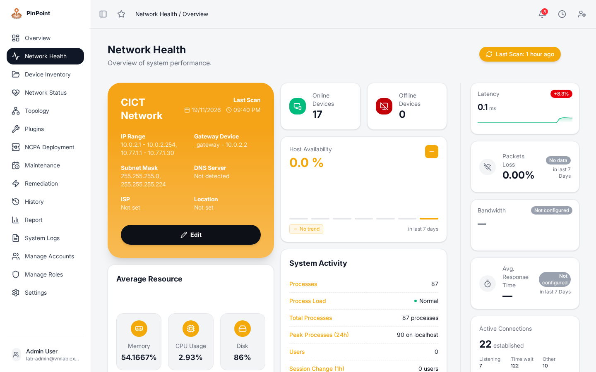
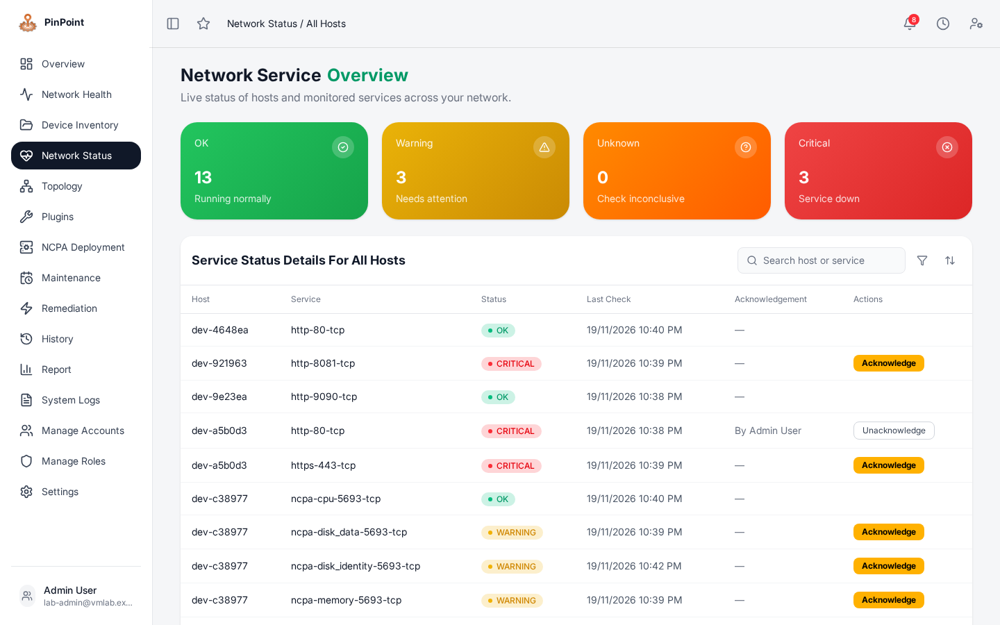
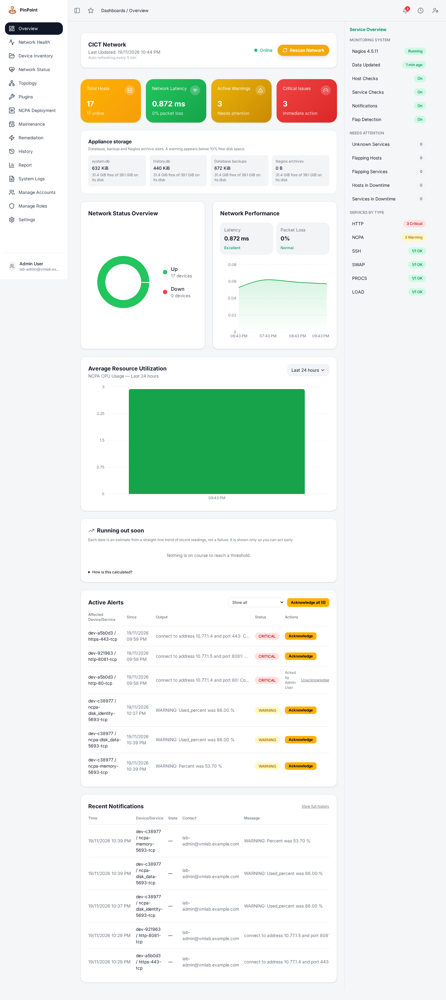

# Dashboard, Network Health and Network Status

Three pages show the current state of the monitored network: the **Dashboard** (the first page after sign-in: is anything broken right now?), **Network Health** (a network-wide summary with trends) and **Network Status** (a service table with acknowledgement). This guide also covers acknowledging alerts and the **Check now** button.

> **Verification status.** Followed on 2026-11-26 on the local lab (6 hosts, no
> NCPA agent, no SNMP interfaces): the Dashboard, acknowledging and
> unacknowledging an alert, Check now, Network Health, Network Status and the
> Device Inventory detail view. Not followed: **Acknowledge all** to completion,
> saving the network information card, a stopped Nagios, flapping, downtime,
> NCPA and bandwidth figures. Those come from the specifications and source.

*Figure: Network Health.*

*Figure: Network Status.*

## Purpose

Nagios Core does the checking; Pinpoint reads the results and presents them. These pages show the latest results, not history. For past events use [Alerts and notification history](Alerts_and_Notification_History.md); for availability over a period use [Service reports](Service_Reports.md).

## Prerequisites

| To use | You need |
|---|---|
| Dashboard | `system.dashboard` |
| Network Health, Network Status, Device Inventory, Topology | `system.network_health` |
| Acknowledge and unacknowledge alerts | `system.acknowledge_alerts` (without it you see the acknowledged state but no controls) |
| **Check now** | `system.recheck` |

At least one monitored host, discovered through [Network Discovery](Network_Discovery.md), is needed for data to appear. Resource figures (CPU, memory, disk) need the NCPA agent on the hosts; see [NCPA deployment](NCPA_Deployment.md).

## Read the Dashboard

1. Choose **Overview** in the sidebar.
2. **Top card:** when the page was last updated, how often it refreshes, whether monitoring is **Online**, and **Rescan Network**.
3. **Summary cards:** **Total Hosts** (and how many are online), **Network Latency** (average, with packet loss), **Active Warnings** and **Critical Issues**. The last card also says how many hosts are down.
4. **Appliance storage:** size of the databases, backups and Nagios archives and free space on each disk; a warning appears when a disk has less than 10% free.
5. **Network Status Overview** shows how many devices are up and down. **Network Performance** shows latency and packet loss.
6. **Average Resource Utilization:** a chart of CPU use from hosts with the NCPA agent, over a time range you choose. It is hidden when no host has the agent.
7. **Running out soon:** disk and memory that are on course to reach a warning or critical level, with an estimated date. It looks up to 90 days ahead. Open **How is this calculated?** for the method.
8. **Active Alerts:** each problem host or service with **Since**, the plugin **Output** and **Status** (marked **Downtime** when it applies). Critical problems come first, then warnings, then unknown; unacknowledged before acknowledged; devices in scheduled downtime last.
9. **Recent Notifications:** the latest notifications Nagios sent. **View full history** opens [History](Alerts_and_Notification_History.md).

The **Service Overview** panel on the right shows on wide screens (about 1280 pixels or more):

| Section | Shows |
|---|---|
| **Monitoring System** | The Nagios version and whether it is running, how long ago Pinpoint read its data (**Data Updated**), and whether host checks, service checks, notifications and flap detection are on |
| **Needs Attention** | Counts of unknown services, flapping hosts and services, and hosts and services in downtime |
| **Services by Type** | State of the services of each kind (for example DISK, SSH, HTTP) |
| **Services Needing Attention** | The services with a problem |

If Nagios is stopped or its status cannot be read, the page says so and the rest may be stale. **Data Updated** changes color after 3 minutes and again after 10.

The page refreshes by itself at the rate set in **Settings → General → Dashboard Refresh Rate** (Manual, 1, 5 or 15 minutes). Reload the browser page to refresh by hand.

Colors: green is OK or UP, yellow is WARNING, red is CRITICAL or DOWN, orange or gray is UNKNOWN or UNREACHABLE, a muted color is acknowledged, blue or purple is scheduled downtime.

*Figure UM-03. The Dashboard with the summary cards, the "last updated" line, two unacknowledged critical alerts, one acknowledged critical alert and three warnings from the NCPA agent checks.*

## Acknowledge an alert

Acknowledging tells your team a problem is known and being handled. It does not fix the problem and does not stop Nagios checking.

1. In the **Active Alerts** list or a **Network Status** row (or a host or service detail view), choose **Acknowledge**.
2. Type the required **comment** and choose **Acknowledge**.
3. The row shows **Acked by** and your name. To undo, choose **Unacknowledge** and confirm; no comment is needed.
4. To acknowledge many at once on the Dashboard, set the acknowledgement filter (**Show all**, **Hide acknowledged**, **Show only acknowledged**), then choose **Acknowledge all** (the number in brackets is how many it will cover). It acts only on the rows currently visible, with one comment for all.

Write a comment others can act on, for example what is wrong, who is handling it and when it should be fixed.

Expected result: who acknowledged, when and the comment are kept and appear on the matching event in [History](Alerts_and_Notification_History.md). When a problem recovers, its acknowledgement is closed automatically.

## Check a host or service in detail

1. Choose **Device Inventory** and select a host. Its detail view opens, with performance data and its warning and critical thresholds, the last state change and last up or down times, **Flap history** (last hour, 6 hours, 24 hours or 7 days) and its services. Select a service to see the same for that service.
2. To find problem hosts, use the search box and the filter (state, monitoring state, **Flapping only**).

### Check now

In a host or service detail view, choose **Check now** (needs `system.recheck`). Nagios runs the check immediately; the page shows "Check requested. The result appears after the next refresh." A target can be re-checked once every 10 seconds, and the button counts down. It is refused for devices that are paused, retired or merged, and fails if Nagios cannot be reached.

## Network Health

Choose **Network Health**. It summarises the whole network; it has no host or service table (use **Device Inventory** or **Network Status** for those).

| Part | Shows |
|---|---|
| **Last Scan** button | When the last network discovery finished. Choosing it starts a new scan (needs `system.discover`) |
| Network information card | IP range, gateway, subnet mask, DNS server, ISP and location. With `settings.discovery`, **Edit** changes the name, reference tag, ISP and location |
| **Online Devices**, **Offline Devices**, **Host Availability** | Current counts, and availability over the last 7 days |
| **Average Resource** and **CPU Utilization** | Figures from hosts with the NCPA agent |
| **System Activity** and **Active Connections** | Processes, users and TCP connections from the checks that report them |
| **Latency**, **Packets Loss**, **Bandwidth**, **Avg. Response Time** | Network figures; **Not configured** means no check supplies the value |
| **Interface Bandwidth** | In and out rates of a monitored SNMP interface. Interfaces are chosen in [Device Inventory](Device_Inventory.md) (Interfaces section) |
| **CPU Load for Nagios server** | Load of the appliance itself |
| **Added Plugins** | Health grouped by kind of check, with a link to **Manage plugins** |
| **Network Health Insights**, **Current Supported Checks** | Short summaries of current problems and the check types in use |

Charts have a time range control where one applies.

## Network Status

**Network Status** (`/system-status`, heading **Network Service Overview**) is a service table with counts of OK, Warning, Unknown and Critical, search by host or service, a filter (state, **Flapping only**), sorting, paging and acknowledgement. Users with `remediation.view` also see a **Recovers automatically** mark on services that have an enabled restart action; it links to [Automatic recovery](Automatic_Recovery.md).

## Precautions and troubleshooting

- A new problem can take up to one Nagios check, plus one Pinpoint poll, plus one browser refresh to appear.
- **A device is missing from counts:** devices that are paused, retired or merged are not checked by Nagios and are left out of every count. See [Device Inventory](Device_Inventory.md).
- **Data looks old:** read **Data Updated** on the Dashboard. Check Nagios is running (Monitoring System section), then the polling and check intervals under **Settings → System**.
- **A value says "Not configured":** the check is not set up for any host. Enable the plugin in [Plugin Manager](Plugin_Manager.md) or add the NCPA metric under **Settings → Plugins**.
- Averages count only hosts that reported in the last check cycle, and say how many.
- **Settings → General → Dashboard Layout** (default, compact or expanded) changes only the spacing and padding of the cards, not their order or labels. It is a personal preference.
