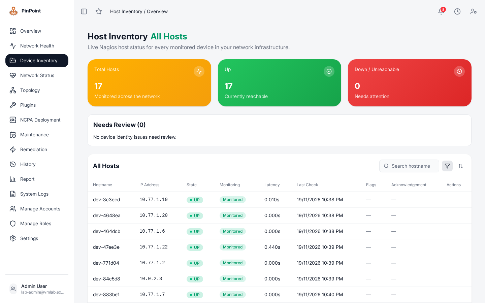
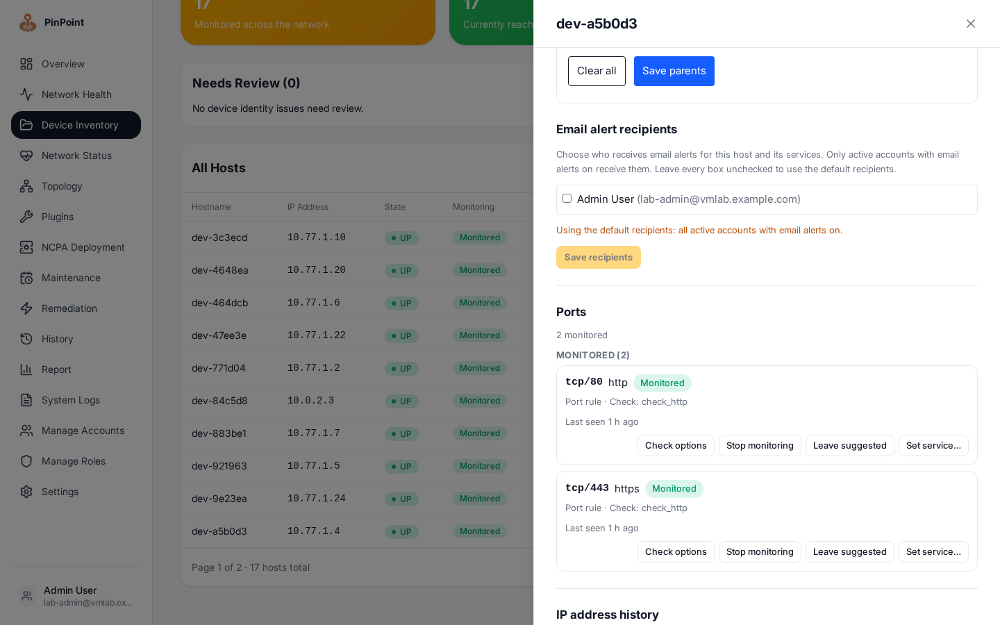

# Device Inventory

**Device Inventory** (`/device-inventory`) lists every device Pinpoint has found, shows whether Nagios is checking it, and lets an administrator change what is monitored. Choosing a hostname opens a detail view with the device's state, ports, interfaces, settings and history.

> **Verification status.** Followed on 2026-11-26 on the local lab: search and
> filters, the detail view, pause and resume, port actions (monitor, ignore, stop,
> leave suggested, pin and remove pin), the check options window, parent devices,
> alert recipients, IP address history, and interfaces and the SNMP **Test** on an
> SNMP version 2c device. Not followed: saving check options or SNMP settings,
> SNMP version 3, missing, retired, merged and archived records, NCPA ports and
> the 16-interface limit. Those come from the specifications and source.
> Duplicate-device merging has its own guide,
> [Review and merge duplicate device records](Device_Identity_Review.md); this
> guide does not repeat it.

*Figure: Device Inventory.*

## Purpose

- Find a device and see its current status.
- See every open port discovery found on it, **why each is or is not monitored**, and change that.
- Pause or resume monitoring of a device.
- Choose interfaces for bandwidth charts, set SNMP options, choose who gets alert email, and set parent devices.

## Prerequisites

| To do this | You need |
|---|---|
| Open the page, see hosts and status | `system.network_health` |
| See ports, interfaces, SNMP, address history | `system.hosts` (and the host must be a discovered device) |
| Change ports, pause or resume, set interfaces, SNMP or parents | `system.hosts.edit` |
| Choose email alert recipients for a host | `system.hosts.alerts` |
| Acknowledge an alert, or **Check now** | `system.acknowledge_alerts`, `system.recheck` |
| Review duplicate devices | `system.discover` (and `system.hosts` to see details, `system.hosts.edit` to merge) |

Devices appear after [Network Discovery](Network_Discovery.md) has run at least once.

## Find and inspect a host

1. Choose **Device Inventory** in the sidebar. The table opens with the **Monitoring** filter on **Monitored**, so devices that are not being checked are hidden until you change it.
2. Search by hostname (the search does not match IP addresses), or use the filter menu: **State** (up, down, unreachable), **Monitoring** (all, monitored, not monitored, or one label) and **Flapping only**.
3. Read the **Monitoring** column. Each device has one label:

   | Label | Meaning |
   |---|---|
   | Monitored | Nagios is checking it (a host with no device record, such as the monitoring server itself, shows "—" and counts as monitored) |
   | Missing | Not seen in the last few scans; still checked, so Nagios reports it down |
   | Address unknown | Its address now belongs to another device; checks are off until it is found again |
   | Paused | An administrator paused it; the status shown is the last Nagios reported |
   | Retired | No longer checked; last status shown |
   | Merged | Merged into another device; last status shown |

4. Choose a hostname to open the detail view (the "drawer"). For Paused, Retired and Merged rows the table shows "last known status": do not read it as live.

Expected result: the drawer shows the current status, performance data and, with the permissions above, the sections below. The **Needs Review** count above the table includes unresolved identity issues even for devices outside the Monitored filter.

## Ports: why each is monitored or not

*Figure UM-04. The Device Inventory drawer for one device, with its **Ports** section listing two monitored ports. Ports that Pinpoint can monitor but you have not chosen appear as suggested.*

The **Ports** section lists each open TCP or UDP port in groups, in this order: **Needs attention**, **Monitored**, **Suggested**, **Stopped**, and **Archived** (collapsed). Each port shows one reason, for example "Held back: left Suggested on purpose", "check_ssh is not enabled in Plugin Manager" or "Not seen lately".

With `system.hosts.edit` you can:

| Action | Effect |
|---|---|
| **Monitor** (or **Acknowledge and monitor** for a port not used as intended) | Starts monitoring; if the check plugin is not enabled the check starts once you enable it ([Plugin Manager](Plugin_Manager.md)) |
| **Ignore** | Hides the port from "needs attention"; no Nagios service |
| **Stop monitoring** | Removes the Nagios service; history is kept; the port becomes Ignored |
| **Leave suggested** | Removes the service and holds the port so no plugin monitors it until you act |
| **Resume** | Monitors an ignored port again |
| **Set service…** | "Pin" what the port is on this device (lowercase letters, digits, `-` or `_`, up to 32 characters); scans no longer rename it. **Remove pin** hands the decision back to scans |
| **Check options** | For monitored http, https, pop3, imap, pop3s and imaps ports: expected text, status codes, virtual host, request method or expected greeting. The options apply to every service of that kind on the device. See [Application checks](Application_Checks.md) |

A port whose plugin is off shows an **Enable** link (for example **Enable check_http**) that opens Plugin Manager. Ignored ports are listed under **Stopped**, and ports left suggested on purpose under **Needs attention**.

Each action that removes a service, and **Remove pin**, asks for confirmation. After a change the drawer reloads. If a notice says "The change was saved but Nagios was not updated", the change is stored but Nagios did not accept the new configuration; give the message to your system administrator.

Precautions: the NCPA port of a device with a deployed agent reads "Managed by NCPA deployment" and offers no actions; see [NCPA deployment](NCPA_Deployment.md). Archived ports have no actions. Without `system.hosts.edit` the section says "You can view ports but not change them."

## Pause and resume monitoring

1. Open the device's drawer, **Monitoring** section.
2. Choose **Pause monitoring** and confirm. Nagios stops checking the device and all its services; scans keep tracking it and its ports and history are kept.
3. To restart, set the **Monitoring** filter to **Paused** (the device is hidden from the default view), open the device, choose **Resume monitoring** and confirm.

Expected result: the chip shows Paused, the device is left out of Dashboard and Network Health counts, and its alerts stop. Only Resume turns a pause off. Retired and merged devices cannot be paused or resumed.

To silence a device for planned work for a limited time, use a [maintenance window](Maintenance_Windows.md) instead; it ends by itself.

## Interfaces and bandwidth (SNMP devices)

For a device with an SNMP port monitored, the **Interfaces** section, at the bottom of the drawer, lists name, index, speed and status of each interface. Choose **Refresh** to read the list from the device. Tick **Monitor** for the interfaces you want charted; the change saves at once, and each interface adds in and out bandwidth checks (and a status check) in Nagios, up to 16 per device. The chart is **Interface Bandwidth** on [Network Health](Dashboard_and_Network_Health.md#network-health). The page shows how many are monitored (for example "3 of 16 monitored") and disables the remaining checkboxes at the limit.

## SNMP settings

The **SNMP monitoring** section sets the version (Default, 1, 2c, 3), the community, and for version 3 the security level, user, authentication and privacy protocols and passwords. Passwords are never shown after saving. **Test** checks the device once without saving; **Save** applies it; **Reset to defaults** returns to the system defaults (**Settings → Plugins**). Test and Save need `system.hosts.edit`.

## Email alert recipients

With `system.hosts.alerts` the drawer shows **Email alert recipients**: one checkbox per user. Only active users with email alerts on receive mail. With no selection, the default recipients (everyone eligible) apply. See [Notification policy](Notification_Policy.md) and [Email settings](Email_Settings.md).

## Parent devices

The **Parent devices** section sets which devices a device depends on for reachability, so that when a router fails the devices behind it are reported **UNREACHABLE** instead of all DOWN. Search for devices, tick one or more parents, and choose **Save parents**; **Clear all** with Save means no parents. The server refuses a device as its own parent and any loop. See [Topology](Topology.md) for the graph. An initial DOWN notice for a child can still be sent before Nagios confirms the parent is down.

## IP address history

For a discovered device, **IP address history** lists every address it has been seen at, newest first, with first seen, last seen and a **Current** mark. It is read-only. A device whose DHCP address changes stays one record.

## Resolve duplicate identity

When Pinpoint thinks two records may be the same device, **Needs Review** shows a count. Follow [Review and merge duplicate device records](Device_Identity_Review.md). Merging cannot be undone, so verify the devices are the same machine first.

## Troubleshooting

- **A device is not in the list:** check the **Monitoring** filter (it opens on Monitored); then check that discovery has covered its network ([Network Discovery](Network_Discovery.md)).
- **A port is not monitored though it is open:** read its reason; the usual cause is that its plugin is not enabled in [Plugin Manager](Plugin_Manager.md).
- **A device shows Missing and DOWN:** it was not seen in recent scans but is still checked. Power it on, or leave it; it is retired automatically after 30 days of absence.
- **Counts differ from Dashboard:** the Dashboard counts only monitored devices.
