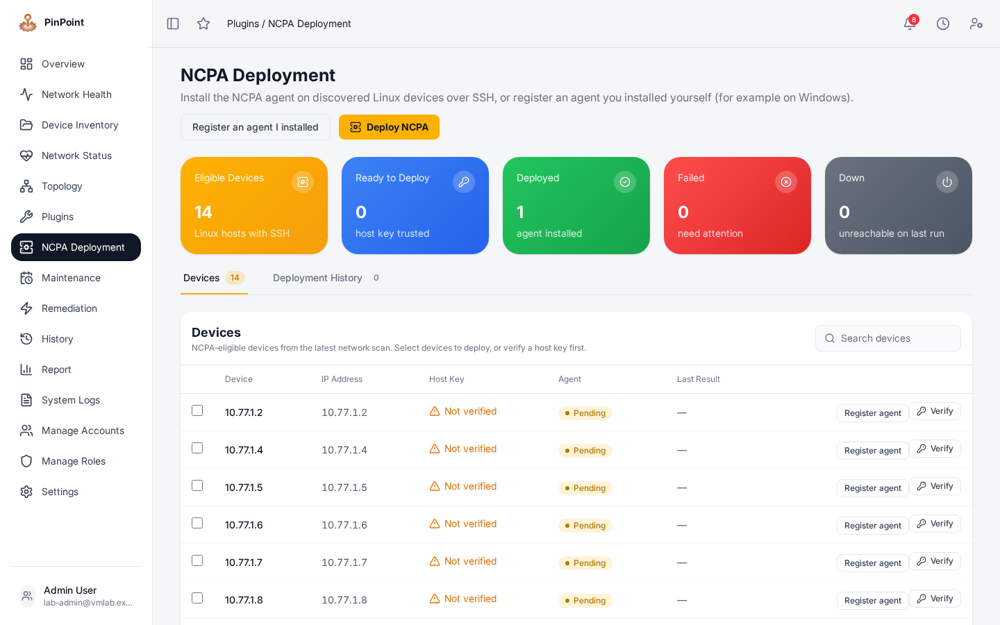
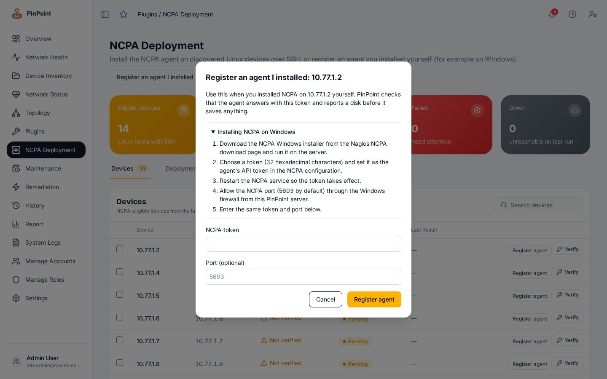

# NCPA deployment and failed-install cleanup

*Figure: NCPA Deployment.*

*Figure: The **Register an agent I installed** dialog, with the install steps expanded.*

The issue #129 build tracks each installed agent's listener port and adds explicit
cleanup of failed deployment bootstrap artifacts. Process-secret transport and
full generated-config live acceptance remains unfinished; this build is
not ready for production security sign-off.

## Deploy and track an agent

Prerequisites: the `system.deploy.ncpa` permission, `check_ncpa` enabled in [Plugin Manager](Plugin_Manager.md), and an SSH login on the Linux server (Debian or Ubuntu based) with administrator rights.

1. Open **NCPA Deployment**.
2. Select the devices and start the deploy wizard.
3. Check and trust each device's SSH host-key fingerprint. Compare it with one obtained from the server itself before you trust it.
4. Enter the login details and run the login check. The details are used for the run and are not shown again.
5. Start the deployment and watch the progress of each device.

Expected result: each device shows a result. Deployed devices report CPU, memory and disk figures after the next checks. Windows agents are installed by hand and then [registered](#register-an-agent-you-installed-yourself-for-example-windows).

Deployment records the configured
`NCPA_PORT` in `NCPADeployment.Port`; checks, disk and identity probes, relocation
and port protection use that installed port. A missing stored port uses the
configured default. Changing the default does not change existing listeners.
There is no re-port control in this build.

Back up both databases before upgrading. From the installed `server` environment,
run `flask db upgrade` and `flask sync-permissions`, then restart the backend.
Migration `7db78f308ee5` backfills deployed agents with the configured legacy port;
make sure that setting matches the ports of existing agents before migration.
The migration handles both binds and can downgrade by removing the Port column.
No new permission is introduced by cleanup.

## Register an agent you installed yourself (for example Windows)

Verified 2026-11-25 on the QA appliance with NCPA 3.5.0 on a Windows VM.

1. Install NCPA on the server by hand. Set a token of 32 hexadecimal characters as the agent's API token, restart the NCPA service, and allow the NCPA port (5693 by default) through the firewall from the Pinpoint server only.
2. Make sure Pinpoint has the device in **Device Inventory**. A device that was off during the last scan is not listed, so scan it first (one-address scan under **Network Discovery**; about 1.5 minutes).
3. Open **NCPA Deployment**, choose **Register agent** for the device, enter the token (and the port if it is not 5693), and save. Pinpoint checks that the agent answers with that token and reports a disk, then saves. This took about 1 second.
4. Open **Plugins** and enable **check_ncpa** (see below). Registering only stores the token and port; nothing is checked until the plugin is enabled.

Expected result: **Agent registered**, with the status `Deployed NCPA` and the disks found (for example `C:`). After `check_ncpa` is enabled, four checks appear within about a minute (CPU, memory, swap and each disk), and the first disk and memory values show about 2 minutes later.

Messages: a token that is not 32 hexadecimal characters is refused with "The NCPA token must be 32 hexadecimal characters."; registering a device that is already deployed is refused with "NCPA is already deployed on this device."

On a new installation no plugin is enabled (65 installed, 0 enabled), so discovered ports stay suggested and no service check runs until you enable the plugins you need.

## Clean up a failed deployment

On a trusted device showing **Deployment Failed**, select **Clean up**. The dialog
lists the deployment key, sudo rule and helper that will be removed. Review the
saved SSH fingerprint, enter an SSH login with sudo access, and optionally choose
to remove the deployment account. The backend checks the live key again before
running any command. If it changed, confirm trust through the deployment wizard
before retrying.

Select **Run cleanup** and read each step's result. The optional account removal
runs only after the other artifacts were successfully removed. Complete cleanup
returns the device to **Pending NCPA** so it can be deployed again. Incomplete
cleanup keeps **Deployment Failed**; review the failed steps before retrying.
Credentials clear after the request and when the dialog closes. The list refreshes
without a page reload. Cleanup does not uninstall NCPA and is unavailable for
healthy deployed agents, untrusted devices or a running deployment.

## Try it in the demo lab

The demo lab's `ssh-alt02` container (`10.77.1.11`, SSH port 2223) accepts the
wizard: discover it, confirm its host key, sign in as `labadmin` and deploy. How
to read the password, how the container reaches its local copy of
`repo.nagios.com`, and what this does not prove are in
[the demo targets guide](../../../demo/targets/README.md#ncpa-deployment-target-ssh-alt02).

## Administrator note: secret storage and outstanding requirements

Custom-check passwords remain encrypted in the application database using the
fixed `PINPOINT_SECRETS_KEY` or `SECRET_KEY`. Do not change that key without a
recovery plan. NCPA tokens remain in `NCPADeployment.Token` on the system bind.
During generation, check secrets are written to the owned block of
`NAGIOS_RESOURCE_CFG` (default `/usr/local/nagios/etc/resource.cfg`). Host config
contains bare USER slot identifiers; Nagios history snapshots retain command names
without arguments. Do not publish resource files or raw check transcripts.

The resource file must retain `nagios:nagios` ownership and mode 0660. The generated
and successfully applied live hosts file uses 0640 with its existing owner/group.
Atomic updates require a supported ownership-preserving installer mechanism;
ordinary group write permission is insufficient. The current writer refuses
unsafe permissions or an update that cannot preserve ownership. Install the restricted
`pinpoint-apply-resources` helper from the paired installer branch before upgrading:
it receives only the managed block on stdin and supports the default resource
path. Foreign-owned custom resource paths are refused. Config generation
and application restore previous resources on failure or cancellation.

NCPA 1.2.4/1.2.5 runs through an adapter that reads the resource slot and supplies
the token in memory, without a child process. Supported native custom checks read
passwords through extra-options stdin. Password-based SMB generation is refused
because the plugin exposes child credentials. Automated process tests pass;
installed ownership/rollback tests and four live adapter metric comparisons pass.
Full generated-config application under the main Nagios service remains unverified. The implementation and installer handoff are tracked in
[the transport plan](../../archive/plans/Issue_129_Check_Secret_Transport.md).
