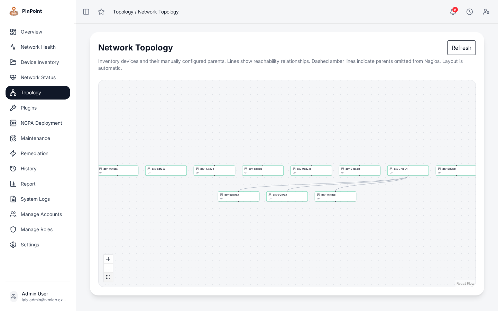

# Network topology

This guide covers the **Network Topology** page: reading the map of devices and their parent relationships, and setting a device's parent.

> **Verification status.** Followed on 2026-11-26 on the local lab: reading the
> map, selecting devices and a line, setting a parent on Topology, clearing it from
> the Device Inventory drawer, a refused loop and a merged device. Not followed:
> dashed lines, **Retry**, the permission rules and the other refusal messages.
> Those come from the specifications and source.

*Figure: Topology.*

## Purpose

Topology draws your devices as a hierarchy. Each line joins a device to its **parent**: the device Nagios should check first, so that when the parent is down its children are reported as unreachable, not as separate failures. These are reachability relationships, not cables.

## Prerequisites

- To view the page: the **system.network_health** permission.
- To change a parent: **system.hosts.edit**.

## Read the map

1. Open **Topology** in the sidebar (`/topology`). The page is titled **Network Topology**.
2. The layout is automatic; devices cannot be dragged and no layout is saved. Use the **Zoom In**, **Zoom Out** and **Fit View** buttons. Each box shows a device name and its state. Merged devices also appear, labelled **merged**. A dashed amber line is a parent that was left out of Nagios.
3. Select a device. **Device Information** shows its name, host name, device ID, IP address, operating system, monitoring state, host status, last check and last seen. **Parent devices** below it shows the device's parents.
4. Select a line. **Parent Relationship** names the parent and the child and says whether Nagios can use the link. **View child and parents** opens the child's details.
5. Choose **Refresh** to reload the map. If loading fails an error appears with **Retry**.

Expected result: a device with no parent sits at the top level, and a child sits below its parent.

## Set or change a parent

1. Select the device, then find **Parent devices**. The same section is in the drawer on [Device Inventory](Device_Inventory.md).
2. Tick one or more parents in the list; **Search parent devices** narrows it. To remove all parents, choose **Clear all** or untick them.
3. Choose **Save parents**. The page confirms "Parent devices saved."
4. Pinpoint saves the parent and rebuilds the Nagios configuration. On the QA appliance (2026-11-25) this took about 0.15 seconds, and the Nagios host definition then listed the parent. The map shows the change the next time it loads; choose **Refresh** on the page to see it straight away (the child then appears one level below its parent).

A retired or merged device shows "Parent relationships are read-only."

Messages when a change is refused (nothing is saved; untick the parent to correct it):
- A loop: "Parent relationships must not create a cycle."
- A device as its own parent: "A device cannot be its own parent."
- A parent that is not in the inventory: "One or more parent devices do not exist."

If Nagios does not accept the rebuilt configuration, the parent is saved but is not yet in Nagios; the server answers with the Nagios message, and the Device Inventory drawer still says "Parent devices saved." This case could not be provoked on the lab, so the on-screen message is unverified.

Precautions:
- A parent must really sit in the network path in front of the device. A wrong parent hides real outages as "unreachable".
- A loop (A under B under A) is refused.
- Removing a device's parent does not remove the device.
- Nagios owns reachability; the map only shows what Nagios was given.
- Pinpoint does not guess parents; you set them.
