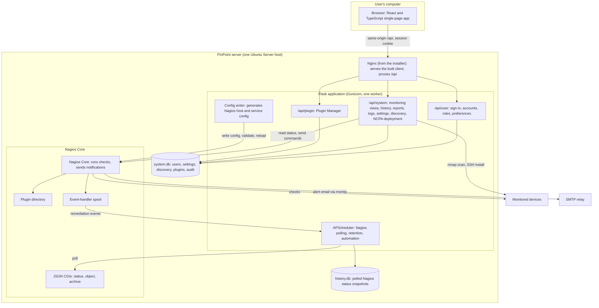
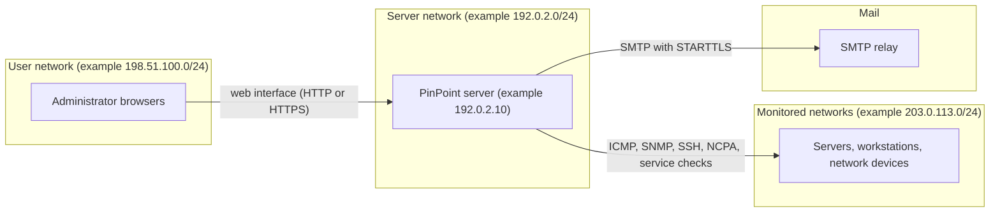

# Architecture and example deployment diagrams

Two hand-written Mermaid diagrams, kept as text so they are easy to review and
change. The entity relationship diagram is separate and generated:
[`ERD.md`](ERD.md).

| Diagram | Shows | Source of truth |
|---|---|---|
| [Software architecture](#software-architecture) | The parts inside the PinPoint server and how they talk | [`System_Overview_and_Architecture.md`](../../spec%20files/System_Overview_and_Architecture.md), Technical Manual sections 1.4 and 2.2 |
| [Example deployment](#example-deployment) | A generic, illustrative placement of the server on a network | Technical Manual section 5 |

The capstone paper's architecture figure (Chapter 4, Figure 61) is the original
of the software diagram. It is cited, not copied; where the two differ, the
specification and the code win.

## Software architecture

One Ubuntu Server host runs everything. There is no cloud component.

How to read it:

- Browsers only ever talk to Nginx. Flask, the databases and Nagios's web
  interface are not exposed to users.
- **Nagios owns monitoring**: it runs checks and decides state. PinPoint polls
  Nagios and stores snapshots in `history.db`; it does not run checks itself.
- **PinPoint owns everything else**: accounts, settings, discovery, plugin
  administration, audit logs and the web interface, all in `system.db`.
- PinPoint writes Nagios configuration, validates it with Nagios, then reloads
  Nagios. It never edits Nagios state directly.

### Checked against the specification

Compared with the runtime diagram in
[`System_Overview_and_Architecture.md`](../../spec%20files/System_Overview_and_Architecture.md):

| Item | Specification | This diagram | Reason |
|---|---|---|---|
| Nginx and Gunicorn | Not drawn; the spec shows the Flask application only | Drawn | Delivered by the separate installer; they explain how the browser reaches Flask |
| `/api/user`, `/api/system`, `/api/plugin` | Listed | Same three groups | Same |
| `system.db`, `history.db` | Listed | Same | Same |
| Nagios JSON CGIs, config files, plugin directory | Listed | Same | Same |
| APScheduler | Listed | Same, plus the event-handler spool feeding remediation | Spool added from Technical Manual section 2.5 |
| Mail | Not drawn | SMTP relay via msmtp | Alert email leaves through Nagios, not Flask |
| Remote devices through nmap and SSH/NCPA | Listed | Same, split into "checks" (Nagios) and "scan, install" (Flask) | Shows which part talks to devices |

### Comparison with the capstone paper

**TBC:** a list of differences between this diagram and the paper's Figure 61
(Chapter 4) has not been prepared, because the figure is not in the repository.
Compare by hand and add the differences here.

## Example deployment

An **illustration only**. Real addresses, VLANs and firewall layout depend on
each site and are decided by the people who run the network. The addresses below
are reserved for documentation (RFC 5737) and are not in use anywhere. The
capstone paper has no network diagram; this one is new.

Guidance that holds on any network (the full table with protocols and
default ports is Technical Manual section 5.5, and firewall guidance is
section 5.7):

- Put the PinPoint server where it can reach every network it monitors. Use a
  static address or a DHCP reservation so users and firewall rules keep working.
- Let only administrator networks reach the web interface.
- Let only the PinPoint server reach the agent and management services on
  monitored devices.
- Allow the server to reach the mail relay and nothing more outbound than it
  needs.
- Keep the example addresses as examples: do not record a real subnet, VLAN or
  firewall rule in this repository.
