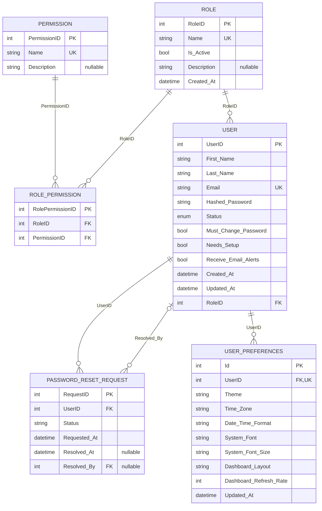
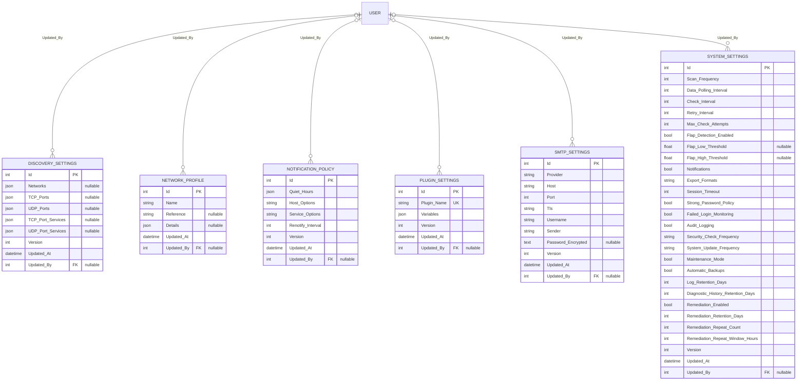
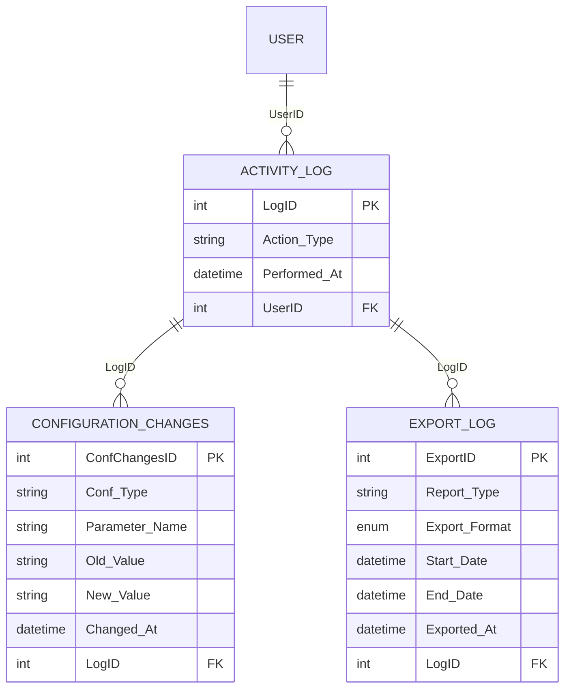
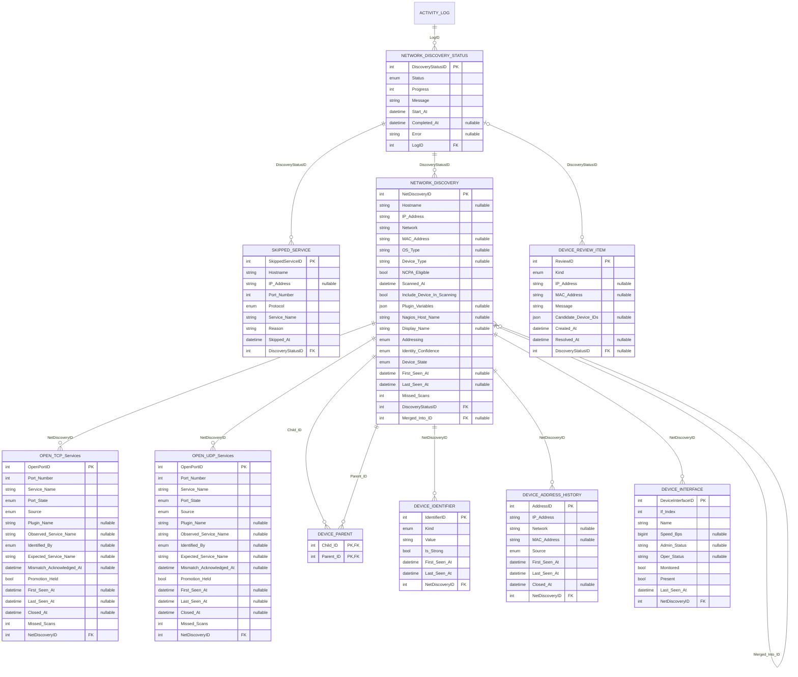
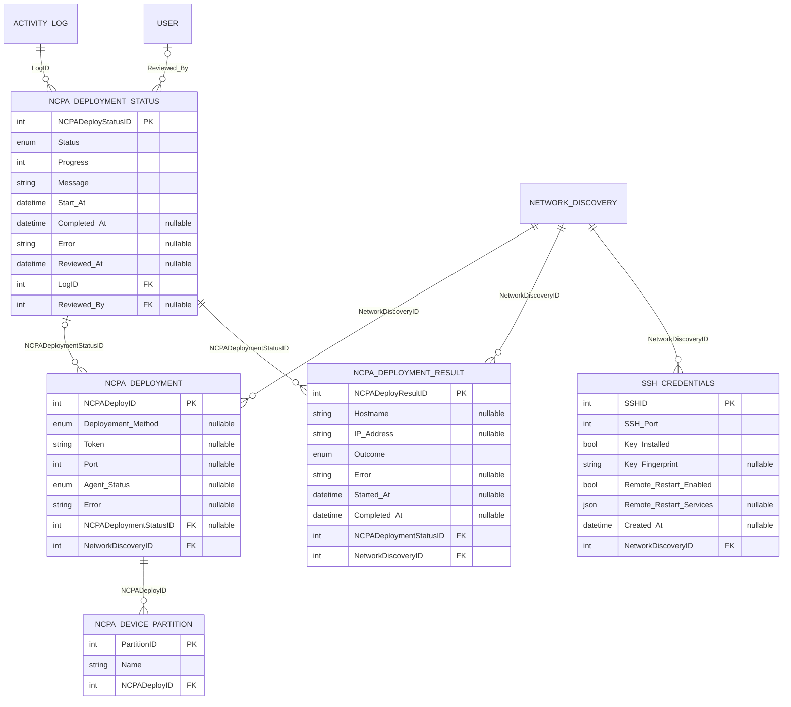
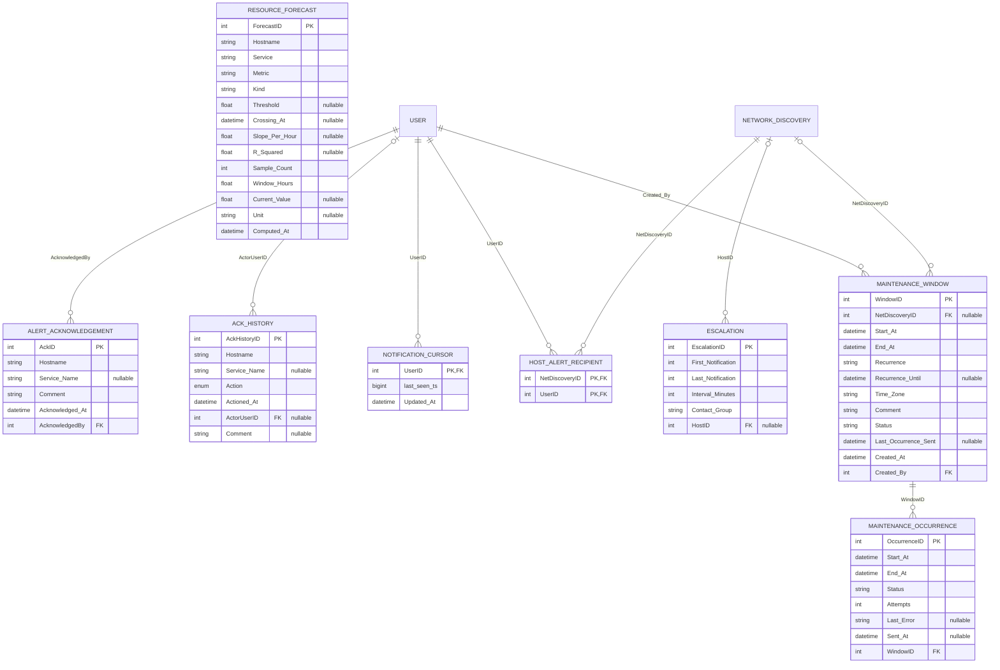
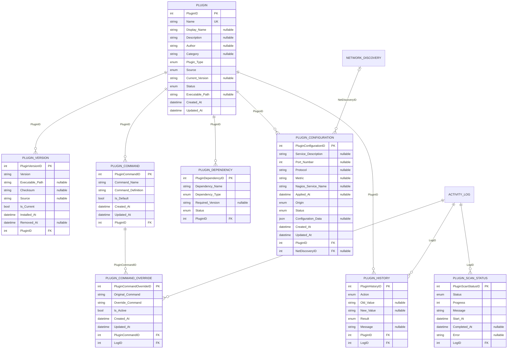
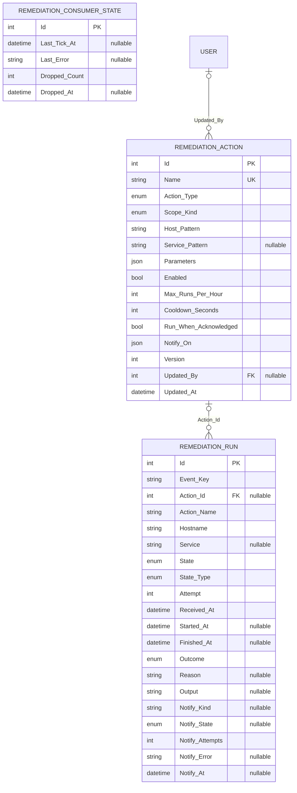
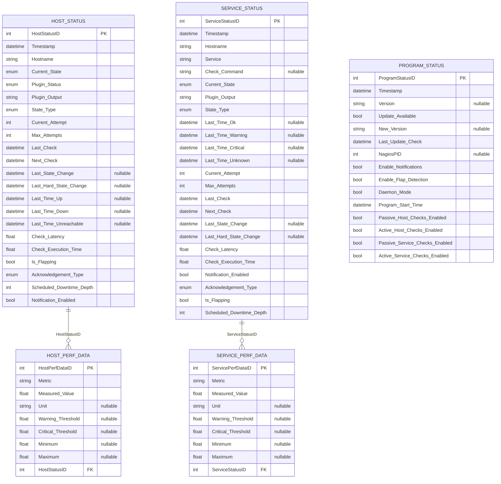

# Entity relationship diagram

<!-- Generated by server/scripts/generate_erd.py from the SQLAlchemy models. -->
<!-- Do not edit by hand; run `python scripts/generate_erd.py` from server/. -->

Generated from `system_models.py`, `plugin_models.py` and `history_models.py`; 54 tables. A unit test (`server/tests/unit/test_erd_doc.py`) fails when this file differs from the models, so it is always current.

Application tables live in `system.db`. The five Nagios snapshot tables live in `history.db` and have no foreign keys to `system.db`. Models: [Data_Model_and_Integrations.md](../../spec%20files/Data_Model_and_Integrations.md).

How to read it:

- A line between two tables is a foreign key, labelled with the column. `||--o{` is one parent to many children; `|o--o{` means the column may be NULL.
- In the detail diagrams `PK` is a primary key, `FK` a foreign key and `UK` a unique column. A column marked "nullable" accepts NULL.
- A detail diagram draws the foreign keys that start in its own tables, so a referenced table from another domain appears without columns. Foreign keys pointing in from other domains are in the Overview.

## Overview

Every table and relationship, without columns.

```mermaid
erDiagram
  USER |o--o{ ACK_HISTORY : "ActorUserID"
  USER ||--o{ ACTIVITY_LOG : "UserID"
  USER ||--o{ ALERT_ACKNOWLEDGEMENT : "AcknowledgedBy"
  ACTIVITY_LOG ||--o{ CONFIGURATION_CHANGES : "LogID"
  NETWORK_DISCOVERY ||--o{ DEVICE_ADDRESS_HISTORY : "NetDiscoveryID"
  NETWORK_DISCOVERY ||--o{ DEVICE_IDENTIFIER : "NetDiscoveryID"
  NETWORK_DISCOVERY ||--o{ DEVICE_INTERFACE : "NetDiscoveryID"
  NETWORK_DISCOVERY ||--o{ DEVICE_PARENT : "Child_ID"
  NETWORK_DISCOVERY ||--o{ DEVICE_PARENT : "Parent_ID"
  NETWORK_DISCOVERY_STATUS |o--o{ DEVICE_REVIEW_ITEM : "DiscoveryStatusID"
  USER |o--o{ DISCOVERY_SETTINGS : "Updated_By"
  NETWORK_DISCOVERY |o--o{ ESCALATION : "HostID"
  ACTIVITY_LOG ||--o{ EXPORT_LOG : "LogID"
  NETWORK_DISCOVERY ||--o{ HOST_ALERT_RECIPIENT : "NetDiscoveryID"
  USER ||--o{ HOST_ALERT_RECIPIENT : "UserID"
  HOST_STATUS ||--o{ HOST_PERF_DATA : "HostStatusID"
  MAINTENANCE_WINDOW ||--o{ MAINTENANCE_OCCURRENCE : "WindowID"
  NETWORK_DISCOVERY |o--o{ MAINTENANCE_WINDOW : "NetDiscoveryID"
  USER ||--o{ MAINTENANCE_WINDOW : "Created_By"
  NCPA_DEPLOYMENT_STATUS |o--o{ NCPA_DEPLOYMENT : "NCPADeploymentStatusID"
  NETWORK_DISCOVERY ||--o{ NCPA_DEPLOYMENT : "NetworkDiscoveryID"
  NCPA_DEPLOYMENT_STATUS ||--o{ NCPA_DEPLOYMENT_RESULT : "NCPADeploymentStatusID"
  NETWORK_DISCOVERY ||--o{ NCPA_DEPLOYMENT_RESULT : "NetworkDiscoveryID"
  ACTIVITY_LOG ||--o{ NCPA_DEPLOYMENT_STATUS : "LogID"
  USER |o--o{ NCPA_DEPLOYMENT_STATUS : "Reviewed_By"
  NCPA_DEPLOYMENT ||--o{ NCPA_DEVICE_PARTITION : "NCPADeployID"
  NETWORK_DISCOVERY_STATUS ||--o{ NETWORK_DISCOVERY : "DiscoveryStatusID"
  NETWORK_DISCOVERY |o--o{ NETWORK_DISCOVERY : "Merged_Into_ID"
  ACTIVITY_LOG ||--o{ NETWORK_DISCOVERY_STATUS : "LogID"
  USER |o--o{ NETWORK_PROFILE : "Updated_By"
  USER ||--o{ NOTIFICATION_CURSOR : "UserID"
  USER |o--o{ NOTIFICATION_POLICY : "Updated_By"
  NETWORK_DISCOVERY ||--o{ OPEN_TCP_Services : "NetDiscoveryID"
  NETWORK_DISCOVERY ||--o{ OPEN_UDP_Services : "NetDiscoveryID"
  USER ||--o{ PASSWORD_RESET_REQUEST : "UserID"
  USER |o--o{ PASSWORD_RESET_REQUEST : "Resolved_By"
  PLUGIN ||--o{ PLUGIN_COMMAND : "PluginID"
  PLUGIN_COMMAND ||--o{ PLUGIN_COMMAND_OVERRIDE : "PluginCommandID"
  ACTIVITY_LOG ||--o{ PLUGIN_COMMAND_OVERRIDE : "LogID"
  PLUGIN ||--o{ PLUGIN_CONFIGURATION : "PluginID"
  NETWORK_DISCOVERY |o--o{ PLUGIN_CONFIGURATION : "NetDiscoveryID"
  PLUGIN ||--o{ PLUGIN_DEPENDENCY : "PluginID"
  PLUGIN ||--o{ PLUGIN_HISTORY : "PluginID"
  ACTIVITY_LOG ||--o{ PLUGIN_HISTORY : "LogID"
  ACTIVITY_LOG ||--o{ PLUGIN_SCAN_STATUS : "LogID"
  USER |o--o{ PLUGIN_SETTINGS : "Updated_By"
  PLUGIN ||--o{ PLUGIN_VERSION : "PluginID"
  USER |o--o{ REMEDIATION_ACTION : "Updated_By"
  REMEDIATION_ACTION |o--o{ REMEDIATION_RUN : "Action_Id"
  ROLE ||--o{ ROLE_PERMISSION : "RoleID"
  PERMISSION ||--o{ ROLE_PERMISSION : "PermissionID"
  SERVICE_STATUS ||--o{ SERVICE_PERF_DATA : "ServiceStatusID"
  NETWORK_DISCOVERY_STATUS ||--o{ SKIPPED_SERVICE : "DiscoveryStatusID"
  USER |o--o{ SMTP_SETTINGS : "Updated_By"
  NETWORK_DISCOVERY ||--o{ SSH_CREDENTIALS : "NetworkDiscoveryID"
  USER |o--o{ SYSTEM_SETTINGS : "Updated_By"
  ROLE ||--o{ USER : "RoleID"
  USER ||--o{ USER_PREFERENCES : "UserID"
  PROGRAM_STATUS
  REMEDIATION_CONSUMER_STATE
  RESOURCE_FORECAST
```

## Accounts and access

Users, roles and permissions, per-user display preferences and password-reset requests.

Tables: PERMISSION, ROLE, ROLE_PERMISSION, USER, USER_PREFERENCES, PASSWORD_RESET_REQUEST.

## Settings

Singleton and per-plugin settings: system, email, notification policy, network profile and discovery.

Tables: SYSTEM_SETTINGS, SMTP_SETTINGS, PLUGIN_SETTINGS, NOTIFICATION_POLICY, NETWORK_PROFILE, DISCOVERY_SETTINGS.

References tables of other domains (drawn without columns): USER.

## Audit log

Who did what: the activity log and the configuration-change and export records attached to it.

Tables: ACTIVITY_LOG, CONFIGURATION_CHANGES, EXPORT_LOG.

References tables of other domains (drawn without columns): USER.

## Discovery and devices

Scan runs, discovered devices and their services, identity evidence, address history, interfaces and manual parent links.

Tables: NETWORK_DISCOVERY_STATUS, SKIPPED_SERVICE, NETWORK_DISCOVERY, OPEN_TCP_Services, OPEN_UDP_Services, DEVICE_PARENT, DEVICE_IDENTIFIER, DEVICE_ADDRESS_HISTORY, DEVICE_INTERFACE, DEVICE_REVIEW_ITEM.

References tables of other domains (drawn without columns): ACTIVITY_LOG.

## NCPA deployment

Stored SSH trust, each remote NCPA install run, and each device's installed agent state.

Tables: SSH_CREDENTIALS, NCPA_DEPLOYMENT_STATUS, NCPA_DEPLOYMENT_RESULT, NCPA_DEPLOYMENT, NCPA_DEVICE_PARTITION.

References tables of other domains (drawn without columns): NETWORK_DISCOVERY, ACTIVITY_LOG, USER.

## Alerts, maintenance and forecasts

Acknowledgements, notification cursors, alert recipients, escalations, maintenance windows and resource forecasts.

Tables: ALERT_ACKNOWLEDGEMENT, ACK_HISTORY, NOTIFICATION_CURSOR, HOST_ALERT_RECIPIENT, ESCALATION, MAINTENANCE_WINDOW, MAINTENANCE_OCCURRENCE, RESOURCE_FORECAST.

References tables of other domains (drawn without columns): USER, NETWORK_DISCOVERY.

## Plugins

Plugin Manager: plugin definitions, versions, commands, dependencies and which targets each plugin monitors.

Tables: PLUGIN, PLUGIN_VERSION, PLUGIN_COMMAND, PLUGIN_COMMAND_OVERRIDE, PLUGIN_DEPENDENCY, PLUGIN_CONFIGURATION, PLUGIN_HISTORY, PLUGIN_SCAN_STATUS.

References tables of other domains (drawn without columns): ACTIVITY_LOG, NETWORK_DISCOVERY.

## Remediation

Automatic-recovery rules, the run recorded for each decision, and the consumer's heartbeat.

Tables: REMEDIATION_ACTION, REMEDIATION_RUN, REMEDIATION_CONSUMER_STATE.

References tables of other domains (drawn without columns): USER.

## Nagios history (history.db)

Polled Nagios status snapshots in the separate history database; no foreign keys to system.db.

Tables: HOST_STATUS, HOST_PERF_DATA, SERVICE_STATUS, SERVICE_PERF_DATA, PROGRAM_STATUS.

